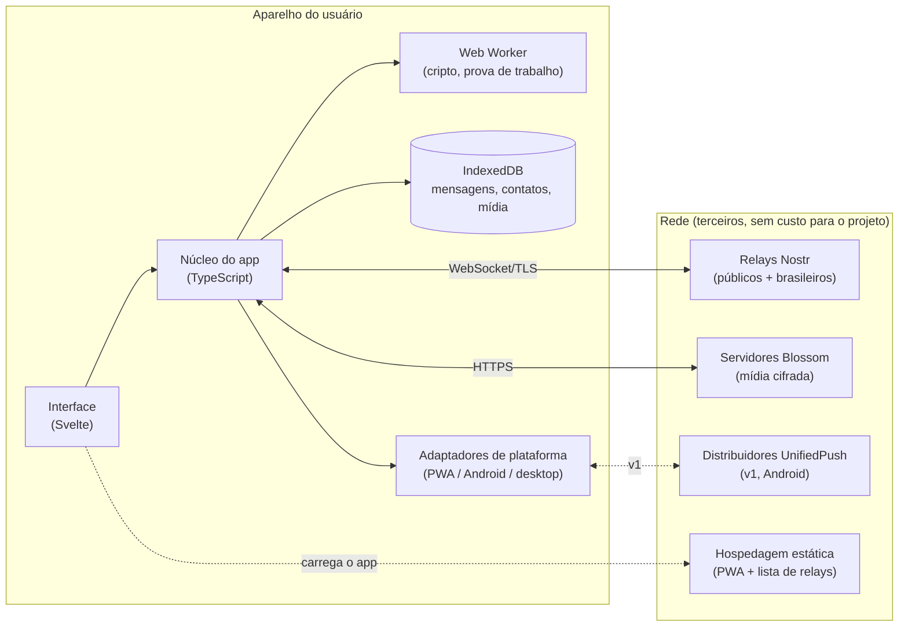
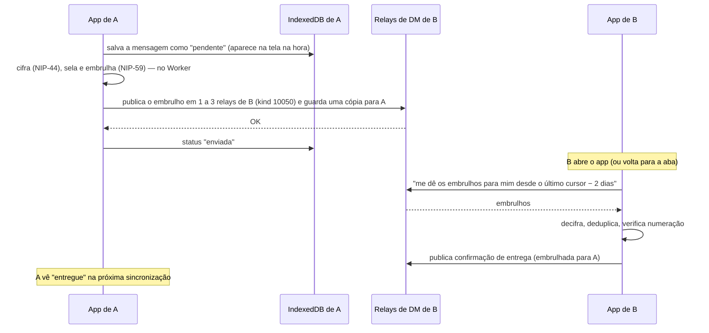
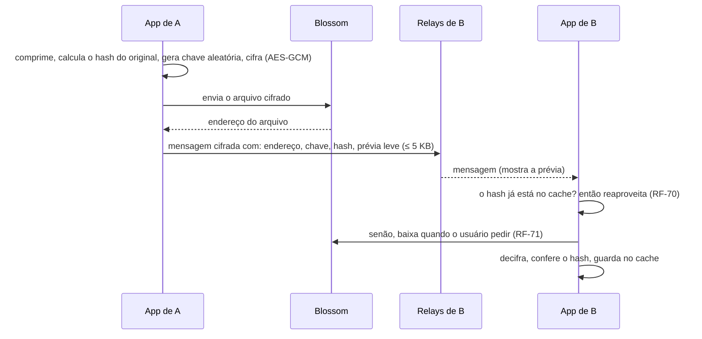

# 05 — Arquitetura

- **Status:** ✅ aprovado
- **Última atualização:** 2026-10-16

## Visão geral

O app é **só cliente**: não há servidor do projeto. Toda a lógica (criptografia, sincronização, grupos, modo foco) roda no aparelho. A rede é formada por peças públicas ou comunitárias, operadas por terceiros.



## Decisões de arquitetura

| ADR | Decisão |
|---|---|
| [0001](adr/0001-protocolo-de-transporte.md) | Protocolo: **Nostr** (NIP-17/44/59), com abstração para trocar por Marmot (MLS) depois |
| [0002](adr/0002-stack-do-cliente.md) | Stack: **TypeScript + Svelte**, núcleo independente da interface; Capacitor (Android) e Tauri/Rust (desktop) na v1 |
| [0003](adr/0003-armazenamento-local.md) | Armazenamento local: **IndexedDB (Dexie)** atrás de uma interface própria |
| [0004](adr/0004-midia.md) | Mídia: cifrada no aparelho, guardada em **Blossom**, deduplicada pelo hash |
| [0005](adr/0005-notificacoes.md) | Notificações: nenhuma no PWA; **UnifiedPush** no Android; conexão própria no desktop |

## Componentes

### Interface (Svelte)

Telas e interação. Não tem lógica de protocolo: conversa só com o núcleo. Isso permite trocar ou adaptar a interface por plataforma sem tocar no núcleo.

### Núcleo do app (TypeScript, sem dependência de interface)

| Módulo | Responsabilidade | Requisitos |
|---|---|---|
| **Identidade** | Gerar chaves; frase de recuperação (NIP-06); restaurar; guardar a chave cifrada | RF-01..06 |
| **Esquema de mensagens** | Interface única `cifrar/decifrar/embrulhar`. Implementação atual: NIP-17 + NIP-44 + NIP-59. Futura: Marmot | ADR-0001, T12 |
| **Pool de relays** | Conectar a vários relays; publicar nos relays de DM do destinatário (kind 10050); reconectar; deduplicar | RNF-30..36 |
| **Motor de sincronização** | Buscar desde o último cursor (com margem de 2 dias por causa dos horários embaralhados do NIP-17); fila de envio offline; reenvio | RF-80/81, RNF-33/34 |
| **Conversas e grupos** | Conversas 1:1 e grupos de até 20; convenção própria para nome, membros e administrador | RF-20..34 |
| **Status de entrega** | Confirmações de entrega e leitura; estado "em modo foco"; numeração por conversa para detectar perdas | RF-50..53 |
| **Atenção** | Modo foco (Reter), agendamentos, exceções, entrega em lotes. Controla **o que a interface mostra**, não o que é recebido | RF-60..63 |
| **Mídia** | Comprimir; cifrar; enviar ao Blossom; baixar sob demanda; cache deduplicado; expiração | RF-40..42, RF-70..73 |
| **Contatos** | QR, link de convite, pedidos de mensagem, bloqueio, nome local | RF-10..14 |
| **Backup** | Backup cifrado de contatos e configurações nos relays | RF-06 |
| **Antispam** | Prova de trabalho (NIP-13) na primeira mensagem a não contatos; filtro de pedidos | RF-90, T7/T8 |

### Web Worker

Criptografia e prova de trabalho rodam fora da thread principal, para a interface não travar no celular de 2 GB (RNF-14, RNF-18).

### Armazenamento local

IndexedDB via Dexie, acessado só pelo repositório do núcleo ([ADR-0003](adr/0003-armazenamento-local.md)). A chave privada é guardada cifrada; no nativo, protegida pelo cofre do sistema (RNF-42).

### Adaptadores de plataforma

Pontos onde PWA, Android e desktop se comportam de forma diferente, atrás de interfaces comuns:

| Adaptador | PWA (MVP) | Android (v1) | Desktop (v1) |
|---|---|---|---|
| Notificações | Nenhuma em segundo plano | UnifiedPush | Conexão própria + notificação do sistema |
| Cofre de chaves | Chave cifrada com PIN no IndexedDB | Android Keystore | Keychain / Credential Manager / Secret Service |
| Câmera (QR) | API do navegador | Plugin Capacitor | API do sistema |
| Galeria / arquivos | Download do navegador | Galeria do Android | Sistema de arquivos |
| Ciclo de vida | `visibilitychange` → sincronizar | Push → acordar → sincronizar | Sempre conectado (bandeja) |

## Peças externas

| Peça | Para quê | Quem opera | Custo para o projeto |
|---|---|---|---|
| Relays Nostr | Guardar e repassar mensagens cifradas (7 dias) | Operadores públicos; meta: voluntários brasileiros | Zero |
| Servidores Blossom | Guardar mídia cifrada | Operadores públicos; meta: voluntários brasileiros | Zero |
| Distribuidores UnifiedPush (v1) | Acordar o app Android | Voluntários brasileiros (ex.: ntfy) | Zero |
| Hospedagem estática | Servir o PWA e a **lista padrão de relays/Blossom** | GitHub Pages ou Cloudflare Pages | Zero |

**Lista padrão de relays (RNF-36):** um arquivo JSON publicado junto com o PWA e também embutido no app como reserva. O app usa a versão mais nova que conseguir obter, e o usuário avançado pode editar a sua. Isso evita que o site de hospedagem vire um ponto único de falha.

## Fluxos principais

### Enviar mensagem 1:1



Se não houver conexão, a mensagem fica na fila e é publicada quando a conexão voltar (RNF-33).

### Enviar mídia



Encaminhar uma mídia reaproveita o mesmo arquivo no Blossom: não há novo envio.

### Modo foco (Reter)

O motor de sincronização **continua recebendo** normalmente. O módulo de Atenção marca as mensagens que chegam como "retidas" e a interface não as mostra nem conta como não lidas até o fim do modo. Se o usuário permitir, a confirmação enviada ao remetente é "retida em modo foco" em vez de "entregue".

## Estrutura do código (proposta)

```
lerolero/
├── docs/                  # esta especificação
├── packages/
│   ├── core/              # núcleo em TypeScript, sem interface (testável isoladamente)
│   └── app/               # interface Svelte + PWA
├── platforms/
│   ├── android/           # Capacitor (v1)
│   └── desktop/           # Tauri (Rust) (v1)
└── relays.json            # lista padrão de relays e Blossom
```

Monorepo com workspaces (ex.: pnpm).

## Questões em aberto

| # | Questão | Responsável |
|---|---|---|
| Q-R1 | Quais relays e servidores Blossom entram na lista padrão do MVP? Critérios: aceitam gift wraps (kind 1059), retêm por 7 dias, exigem autenticação para leitura (NIP-42), preferencialmente no Brasil (Q-D2). **Em andamento (2026-10-22):** lista provisória em `relays.json`; dos 100 relays de DM mais usados, só 7 protegem os gift wraps de quem não é o destinatário, e nenhum fica no Brasil. Falta confirmar a retenção. Detalhes em [prototipos/relays](../prototipos/relays/README.md) | Implementação |
| Q-R2 | Formato do áudio entre navegadores: Chrome e Firefox gravam Opus nativamente; o Safari historicamente grava AAC. Opções: aceitar formatos mistos ou usar um codificador Opus em WebAssembly carregado só quando necessário | Implementação |
| Q-R3 | ✅ No PWA, a chave privada é cifrada com um **PIN** escolhido pelo usuário no cadastro e pedido ao abrir o app. No nativo, o cofre do sistema substitui o PIN (que vira opcional, RF-07) | — |
