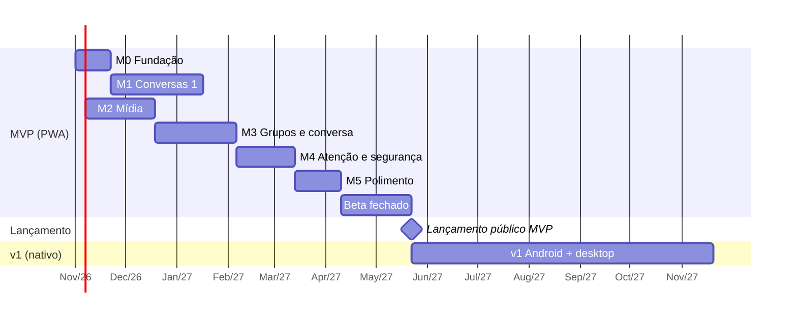

# 07 — Roadmap

- **Status:** ✅ aprovado
- **Última atualização:** 2026-10-16

## Premissas

- **Dedicação:** ~5 h por semana, com o Claude ajudando na implementação. As estimativas incluem o tempo de revisar, testar e entender o código, não só de escrevê-lo.
- **Estimativas em semanas de trabalho** (1 semana = ~5 h). São faixas, não promessas: revisar a cada marco concluído.
- **Lançamento em duas etapas:** beta fechado (você + 10–20 amigos e familiares) antes de abrir ao público.
- Início considerado: **novembro de 2026**.

## Visão geral

Somando: **~33 semanas de desenvolvimento + 6 de beta** → MVP público por volta do **3º trimestre de 2027**; v1 por volta do **1º trimestre de 2028**.

## MVP (PWA)

### M0 — Fundação (~3 semanas)

- Monorepo (`packages/core`, `packages/app`), TypeScript, Svelte, Vite, testes, integração contínua (GitHub Actions), licença AGPL-3.0.
- Publicar o PWA vazio no GitHub Pages.
- Pesquisar e testar relays e servidores Blossom para a lista padrão (Q-R1); criar `relays.json`.
- **Protótipo de medição:** abrir uma conexão com relays, cifrar/decifrar uma mensagem e rodar o Argon2id **no aparelho de referência** (Android 2 GB) para validar as metas de desempenho (Q-N4).

**Pronto quando:** o PWA "vazio" abre no celular de referência; os testes rodam a cada commit; existe uma lista inicial de pelo menos 5 relays compatíveis.

**Andamento (2026-10-22):** monorepo, CI, licença e PWA publicados; protótipo de medição pronto e rodado num celular intermediário (não o de referência); lista provisória com 7 relays aptos. Faltam: medir no aparelho de 2 GB (decide o ADR-0002) e confirmar a retenção dos relays a partir de 2026-10-29.

### M1 — Conversas 1:1 (~8 semanas)

- Identidade: criação, frase de recuperação em português com teste de verificação, PIN, restauração (RF-01, 03, 04, 05).
- Contatos por QR e link de convite; nome local (RF-10, 11, 14).
- Envio e recebimento de texto via NIP-17; lista de conversas; não lidas (RF-20, 21).
- Motor de sincronização: cursor, margem de 2 dias, deduplicação, fila offline (RF-80, 81; RNF-30..35).
- Banco local (Dexie) com as tabelas de identidade, contatos, conversas, mensagens, fila, sincronização.

**Pronto quando:** duas pessoas em aparelhos diferentes criam a identidade, se adicionam por QR e trocam mensagens, inclusive com um dos dois offline por um dia; restaurar a identidade num aparelho novo funciona.

### M2 — Mídia (~6 semanas)

- Áudio: gravação, envio, reprodução 1x/1,5x/2x (RF-40); decidir o formato no Safari (Q-R2).
- Fotos: compressão, prévia leve, download sob demanda (RF-41, 71).
- Cifra e envio ao Blossom; deduplicação por hash; encaminhar sem reenviar (RF-42, 70).
- Expiração de mídia (30 dias, "guardar") e painel de armazenamento (RF-72, 73).
- **Suite de testes de ponta a ponta** (`packages/e2e`, Playwright): cadastro e PIN, restauração, convite e QR, conversa entre duas pessoas, áudio, atualização do app e comentário. Roda na CI a cada push contra o relay e o Blossom falsos (sem internet) e, uma vez por dia ou sob demanda, contra a rede real. Daqui em diante, cada funcionalidade nova entra com o seu teste.
- Cartão de perfil privado com nome e foto (Q-P5, RF-02).
- **Excluir áudio e mídia:** apagar para mim (mensagem e arquivo no aparelho) e apagar para todos (pedido cifrado ao contato, como no RF-25, e remoção do arquivo dos servidores Blossom por quem enviou).
- **Melhorias de UX/UI** (escolhidas pelo Pedro em 2026-10-22), em 3 etapas:
  1. Tela inicial: lista de conversas ocupando a tela, com ícones de Contatos e Ajustes e botão flutuante de nova conversa; avatares com iniciais (cor fixa por contato) na lista e no topo da conversa; estado vazio com "Convidar alguém" e "Ler QR code".
  2. Conversa: balões seguidos da mesma pessoa agrupados; data do dia presa no topo ao rolar; botão "ir para o fim" com o número de mensagens novas e linha "Mensagens novas"; "Copiar" no menu da mensagem, com vibração curta ao abrir.
  3. Geral: aviso de "sem conexão"; tamanho da letra em Ajustes (Normal, Grande, Muito grande; RNF-65); nível do microfone durante a gravação.
- **Ajustes pedidos pelo Pedro depois de usar o app (2026-10-22):** ✅ recarregar a página sem pedir o PIN se o app foi usado nos últimos 5 minutos (T16); ✅ áudio a ~28 kbps com controle automático de volume, porque em lugar barulhento a voz ficava ruim. Se ainda não bastar, supressão de ruído forte no aparelho (RNNoise em WebAssembly, ~150 KB a mais no app). Conferido: a hora mostrada na mensagem já é a do envio (vem do celular de quem enviou).
- **Aviso de versão nova mais rápido** (notado pelo Pedro em 2026-10-22, só registrado): hoje o aviso pode levar 10 minutos ou mais depois da publicação. A CI leva ~1 minuto; o GitHub Pages guarda os arquivos em cache por até 10 minutos (`max-age=600`); e o app só procura versão nova quando volta para a tela. Melhorias possíveis: procurar também a cada poucos minutos com o app aberto. O cache do Pages não dá para encurtar; com domínio próprio (Q-N1) e outro hospedeiro, sim.
- **Bug: o teclado esconde as mensagens numa conversa com poucas mensagens** (visto pelo Pedro no celular em 2026-10-22, só registrado): com a tela da conversa meio vazia, tocar no campo de texto abre o teclado, o conteúdo sobe e as mensagens anteriores saem da tela. O esperado é que as últimas mensagens continuem visíveis logo acima do campo. Resolver junto com a etapa 2 de UX/UI, com teste de regressão.

**Andamento (2026-10-22):** Blossom, áudio (Opus a ~17 kbps, Q-R2 resolvida) e exclusão de mensagens e áudios prontos e publicados; etapa 1 de UX/UI publicada. **Grupos (RF-30..33) adiantados do M3** a pedido do Pedro (2026-10-22): são o uso principal no Brasil e mudam a tela da conversa (nome de quem escreveu nos balões), então a etapa 2 de UX vem depois, já pensada para grupos. Ordem a seguir: grupos (✅ core: dados e envio/recebimento; ✅ tela: criar o grupo e conversar nele, com avisos na conversa e nome de quem escreveu nos balões; gestão: tela de detalhes do grupo, aberta ao tocar no nome do grupo no topo da conversa (pedido do Pedro em 2026-10-22), com membros, administradores, renomear e sair), etapas 2 e 3 de UX/UI, suite e2e, fotos, cartão de perfil, expiração.

**Pronto quando:** os critérios de aceite "Mídia salva uma vez" passam; 1 minuto de áudio fica em torno de 210 KB e uma foto em até 200 KB.

### M3 — Grupos e recursos de conversa (~7 semanas)

- ~~Grupos de até 20 com tag `g` e eventos de controle; administrador; remover membro (RF-30..33).~~ Adiantado para o M2 (2026-10-22).
- Responder, reagir, editar, apagar para todos (RF-22..25).
- Mencionar alguém no grupo com `@` (RF-35). Avaliar se a menção fura o modo foco, como exceção (RF-61).
- Status de entrega com confirmações agrupadas; confirmação de leitura desativável (RF-50, 51).
- Detecção de perdas: numeração por conversa + pedido de reenvio + prazo de 7 dias (RF-53).

**Pronto quando:** um grupo de 5 pessoas funciona com entrada e saída de membros; os status aparecem corretamente; uma mensagem apagada propositalmente de um relay de teste é detectada e reenviada.

### M4 — Atenção e segurança (~5 semanas)

- Modo foco (Reter): manual, por tempo, agendado, exceções; estado "retida" (RF-52, 60..62).
- Entrega em lotes, desligada por padrão (RF-63).
- Pedidos de mensagem, bloqueio, prova de trabalho (RF-12, 13, 90).
- Backup cifrado de contatos, grupos e configurações (RF-06).

**Pronto quando:** os critérios de aceite "Modo foco" e "Perda de identidade" passam; a prova de trabalho leva menos de 1 s no aparelho de referência.

### M5 — Polimento (~4 semanas)

- Revisão de acessibilidade WCAG 2.2 AA com leitor de tela (RNF-60..63).
- Revisão de textos para linguagem simples (RNF-64).
- Medição de todas as metas de desempenho e dados no aparelho de referência (seções 2 e 3 do [04](04-requisitos-nao-funcionais.md)).
- Correção dos problemas encontrados; *Could* (RF-02, 26) só se sobrar tempo.

**Pronto quando:** as metas de desempenho são atingidas ou têm justificativa documentada; o fluxo de primeiro uso leva menos de 2 minutos com uma pessoa leiga.

### Revisão de prontidão para produção (antes do beta)

Revisão do app inteiro com olhar de operação. Como não há servidor do projeto, cada tema muda de foco:

| Tema | O que revisar |
|---|---|
| Confiabilidade | Entrega de mensagens de ponta a ponta (perdas, repetidas, ordem), fila offline, retenção real dos relays, comportamento com relays e servidores Blossom fora do ar |
| Escalabilidade | Limites e capacidade dos relays e servidores Blossom de terceiros (taxa de envio, tamanho, retenção); dependência de poucos operadores; desempenho do app com muitas conversas e mensagens no aparelho de referência |
| Resiliência | Recuperação de falhas: reconexão, troca de relays, lista padrão atualizável (RNF-36), dados locais apagados pelo navegador, restauração pela frase |
| Segurança | Auditoria externa da criptografia e do cofre; dependências e cadeia de suprimentos (npm, CI); política de segurança de conteúdo (CSP) do PWA; tratamento de dados vindos de fora; canal para relatar vulnerabilidades |
| Monitoramento | Sondas sintéticas (contas de teste trocando mensagens pela rede real, a partir da CI), painel de saúde dos relays e servidores Blossom, diagnóstico local enviado pela própria pessoa (Enviar comentário); decidir a Q-N6 (dados técnicos de uso com consentimento) |
| Lançamento e volta atrás | Processo de publicação, como reverter uma versão ruim (service worker, cache), migrações do banco local sem perder dados, comunicação de incidentes a quem usa |

**Pronto quando:** cada tema tem os riscos listados com mitigação ou aceite documentado, e os itens críticos estão resolvidos.

### Beta fechado (~6 semanas de uso)

- 10–20 pessoas, incluindo pelo menos algumas idosas ou com pouca familiaridade digital (RNF-65).
- Canal simples de feedback (ex.: um grupo no próprio app).
- Acompanhar: mensagens perdidas, dificuldades de cadastro, consumo de dados, travamentos.

**Pronto para o lançamento público quando:**
- nenhuma perda de mensagem sem detecção;
- todos os participantes conseguiram cadastrar, adicionar contatos e mandar áudio sem ajuda;
- orientação jurídica obtida (Q-N3);
- decisão sobre domínio próprio (Q-N1);
- guia publicado para voluntários rodarem relays e servidores Blossom (Q8 da Visão).

## v1 — Android e desktop nativos (~26 semanas)

| Item | Requisitos |
|---|---|
| App Android com Capacitor; APK direto assinado | RNF-02, 81 |
| Notificações com UnifiedPush; decidir quem dispara o "acorde" ([ADR-0005](adr/0005-notificacoes.md)) | RF-82 |
| App desktop com Tauri: bandeja, conexão própria, notificações | RNF-03, 83 |
| Chave no cofre do sistema; PIN/biometria opcional | RF-07, RNF-42 |
| Figurinhas, incluindo a figurinha sonora (Q-F5, Q-P2) | RF-43 |
| Modos de banda | RF-74 |
| Modo foco Pausar; aviso automático | RF-64, 65 |
| Mensagens temporárias | RF-27 |
| Builds reproduzíveis do APK | RNF-46 |

**Programa de relays brasileiros (em paralelo):** documentação, contato com comunidades de software livre, universidades e coletivos; meta de N operadores brasileiros independentes (métrica da [Visão](01-visao.md)).

## Futuro (sem ordem definida)

- **Forward secrecy com Marmot (MLS)** — reavaliar ~12 meses após o ADR-0001 (out/2027).
- Grupos grandes (RF-34).
- Multi-dispositivo.
- Chamadas de voz e vídeo.
- iOS; Google Play (Q-N2); notarização no macOS (Q-N5).
- Recuperação de conveniência: passkeys, Pix, gov.br (RF-08, Q-A6, Q-A7) e busca por CPF/Pix (RF-15).
- Antigolpe: verificação de contato, alerta de chave nova, alertas locais (RF-16, Q-A4).
- Denúncia e listas de bloqueio compartilhadas (RF-17).
- Resumo periódico (RF-66); arquivos e vídeos (RF-44).

## Pontos de decisão

| Quando | Decisão |
|---|---|
| Fim do M0 | O desempenho medido no aparelho de referência confirma PWA + Svelte? Se não, rever o [ADR-0002](adr/0002-stack-do-cliente.md) |
| Fim do beta | Lançar publicamente ou fazer mais uma rodada de correções |
| Início da v1 | Quem dispara o push no Android; Capacitor ou Tauri 2 para Android |
| Out/2027 | Marmot está maduro o suficiente para forward secrecy? ([ADR-0001](adr/0001-protocolo-de-transporte.md)) |

## Questões em aberto

| # | Questão | Responsável |
|---|---|---|
| Q-M1 | Revisar as estimativas ao fim do M1, com base no ritmo real | Pedro |
