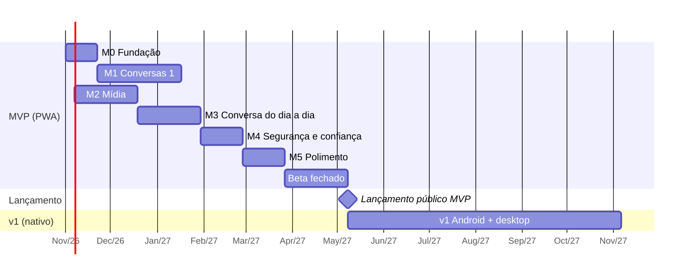

# 07 — Roadmap

- **Status:** ✅ aprovado
- **Última atualização:** 2026-10-27

## Premissas

- **Dedicação:** ~5 h por semana, com o Claude ajudando na implementação. As estimativas incluem o tempo de revisar, testar e entender o código, não só de escrevê-lo.
- **Estimativas em semanas de trabalho** (1 semana = ~5 h). São faixas, não promessas: revisar a cada marco concluído.
- **Lançamento em duas etapas:** beta fechado (você + 10–20 amigos e familiares) antes de abrir ao público.
- Início considerado: **novembro de 2026**.

## Visão geral

Somando: **~31 semanas de desenvolvimento + 6 de beta** (eram 33 antes da repriorização de 2026-10-22) → MVP público por volta do **3º trimestre de 2027**; v1 por volta do **1º trimestre de 2028**.

## MVP (PWA)

### Ordem do restante do MVP (repriorizada em 2026-10-22)

Critério escolhido pelo Pedro: **uso no dia a dia**, o que faz um grupo de amigos usar o app em vez do WhatsApp. A suíte e2e vem antes, para os bugs pararem de chegar ao celular. Ritmo real até aqui: de 16 a 22/10 saíram M0 (menos as esperas), M1, quase todo o M2 e os grupos, o equivalente a ~15 semanas das estimativas (Q-M1).

1. Suíte de testes de ponta a ponta na CI (M2), e em seguida a homologação antes da produção ([ADR-0007](adr/0007-homologacao.md)).
2. Internacionalização: textos fora do código, ADR do mecanismo (M3; vem antes das telas novas, porque cada uma acrescenta texto fixo em português; ordem aprovada pelo Pedro). ✅ Feita em 2026-10-27 ([ADR-0008](adr/0008-internacionalizacao.md)).
3. Fotos e encaminhar sem reenviar (M2).
4. Responder e reagir (M3).
5. Status de entrega e de leitura (M3).
6. Seleção de várias mensagens: favoritar, excluir, copiar e encaminhar (M3; depende do encaminhar do item 3).
7. Etapa 3 de UX/UI: aviso de sem conexão, tamanho da letra, nível do microfone (M3).
8. Cartão de perfil privado com nome e foto (M3).
9. Editar mensagem e mencionar com `@` (M3).
10. Backup cifrado de contatos, grupos e configurações (M4).
11. Pedidos de mensagem, bloqueio e prova de trabalho (M4). ✅ Pedidos e bloqueio feitos em 2026-10-26; falta a prova de trabalho.
12. Detecção de perdas (M4).
13. Guardar o código de recuperação em arquivo ou cartão (M4; D2 do [ADR-0009](adr/0009-protecao-e-recuperacao-da-conta.md), RF-09 a): botão que abre o menu de compartilhar com um arquivo autoexplicativo (explicação, link de restauração e as 12 palavras), opção de imprimir o cartão, restaurar a partir do arquivo ou do link, e a tela "Proteção da conta" com o estado. Sem dependências; entra com e2e.
14. Frase no gerenciador de senhas (M4; D1, RF-09 b): **começa por um protótipo que mede, no Motorola Edge 60 e num iPhone, se o navegador oferece "Salvar senha?" no PWA instalado**; o resultado decide se a camada entra (o ADR prevê rever se não aparecer).
15. Passkey (M4; C, RF-08): entrar com digital ou rosto e restaurar em aparelho novo, com o backup cifrado pela chave PRF nos relays. **Só depois da decisão do domínio (Q-N1)**; mantém a frase como base.
16. Polimento (M5), com a velocidade da suíte e2e, revisão de prontidão e beta.

**Achados e pedidos do Pedro depois de usar o app (2026-10-26), ainda sem implementar:**

- **Bug (✅ corrigido em 2026-10-26, teste e2e `envio-sem-rede`):** ao adicionar uma pessoa nova com os relays fora do ar, a mensagem "sumia" ao enviar, em vez de ficar pendente e sair depois. Causa encontrada no código: no envio 1:1, a busca de onde o contato recebe (`deliveryRelays`, até ~10 s por relay fora do ar) roda **antes** de guardar a mensagem. Enquanto isso o campo já foi limpo e nada aparece na conversa; se a busca falha ou a pessoa sai da tela, a mensagem se perde. A fila de envio (outbox) existe e funciona, mas só recebe a mensagem depois. Correção: a mensagem é guardada como "pendente" primeiro e os relays são buscados depois (RNF-12). Se não houver para onde enviar (`NoRelaysError`), ela é removida e o texto volta ao campo. Sobra uma janela de ~10 s em que fechar o app deixa a mensagem pendente sem entrada na fila; fica anotada.
- **Bug: mensagem perdida se o app fecha ou recarrega enquanto ela chega (✅ corrigido em 2026-10-26, teste `sync.test.ts`).** Achado numa falha da CI do e2e `excluir-conversa` (a Maria recarregava a página no instante em que a mensagem do João chegava e nunca mais a recebeu). Causa: o motor marcava o embrulho como "visto" **antes** de abri-lo e guardar a mensagem; se o app morresse nesse meio-tempo (recarregar, fechar, o sistema matar o app, comum no celular), a próxima sincronização o ignorava para sempre. Correção: o embrulho só é marcado depois de processado (o inválido também, para não ser tentado de novo a cada sincronização); processar duas vezes é seguro porque guardar a mensagem já dedupa pelo id. O teste do core faz um motor "morrer" no meio e confere que o seguinte processa o embrulho. Fica de fora: falha de gravação no banco (cota cheia, erro do navegador) ainda perde a mensagem, porque o embrulho é marcado mesmo quando o processamento lança. **Segundo buraco do mesmo tipo (✅ corrigido em 2026-10-27, teste `messaging.test.ts`):** o traço da CI do e2e `excluir-conversa` mostrou o embrulho chegando duas vezes (a página recarregou na hora) e a conversa nunca aparecendo. Guardar a mensagem e criar a conversa são gravações separadas; se o app morre entre as duas, ao reprocessar a mensagem já existia e o código devolvia \"já conhecida\" sem criar a conversa. Agora, mensagem conhecida sem conversa refaz o resto. Provavelmente é a mesma causa do `conversa` que falhou uma vez na CI.
- **Pedidos de mensagem e bloqueio (✅ feito em 2026-10-26, RF-12 e RF-13; testes `requests.test.ts`, e2e `pedidos`; escolhas do Pedro).** Quem escreve sem ser contato vira **pedido**: a conversa não entra na lista; fica em **Contatos › Pedidos de mensagem (N)**, e um **ponto simples no ícone de Contatos** da tela inicial avisa que há pedido (sem número, sem notificação, como o Instagram). Abrindo o pedido: banner com **Aceitar** e **Bloquear**; links ficam texto (T18) e áudio não é baixado nem toca ("Aceite o pedido para ouvir"). **Aceitar** vira contato e a conversa passa para a lista. **Bloquear** (também na tela do contato) apaga a conversa do aparelho, como "Excluir conversa", e **descarta o que vier dessa chave**, no 1:1 e nas mensagens de grupo (os avisos de grupo continuam valendo); sem aviso a quem foi bloqueado. **Bloqueados (N)** em Contatos, com **Desbloquear**: volta a poder escrever e, se escrever, cai nos pedidos; as mensagens de antes não voltam. Fica de fora: a prova de trabalho (RF-90, T8). **Pedidos vindos de grupo (✅ feito em 2026-10-28, testes `groups.test.ts` e e2e `pedidos`):** quem me põe num grupo sem ser contato aceito faz o grupo virar pedido, em Contatos junto dos pedidos de conversa, e não na lista; aberto, tem Aceitar e Bloquear, links em texto, áudio fechado e sem campo de mensagem, e o app **não se apresenta aos membros nem repassa avisos até aceitar** (T7). Bloquear bloqueia quem me adicionou, apaga as mensagens e descarta o que vier do grupo, sem aviso; o estado do grupo fica, para um aviso novo não o trazer de volta. Grupos que já existiam seguem normais. Para a organização da página de Contatos, ver a conversa de 2026-10-28 (em aberto). Achado no caminho (corrigido): a data do dia no topo (`updateFloatingDay`) desistia se o bloco ainda não estava desenhado; agora tenta nos quadros seguintes.
- **Contatos em abas: pedidos separados dos contatos (✅ feito em 2026-10-28, e2e `pedidos`, `conversa` e `textos`; decidido pelo Pedro).** Hoje a página de Contatos empilha "Pedidos de mensagem" e a lista com o mesmo estilo de linha, e um pedido (gente sem confiança) parece um contato. Opções consideradas: tela própria de pedidos, abas, cartão na mesma página, linha na lista de conversas, cabeçalho fixo, pedidos recolhidos e só um banner. **Escolhida: abas "Contatos | Pedidos (N)"** na mesma página. Desenho combinado: (1) o número fica na aba, sempre visível; sem pedido, a aba continua lá, esmaecida e sem número, para a posição não pular; (2) o ponto do ícone de Contatos na tela inicial abre direto a aba Pedidos (`/contatos?aba=pedidos`); sem pedido, abre em Contatos, que é a aba padrão; (3) **Bloqueados (N)** vão para o fim da aba Pedidos, não numa terceira aba (os dois são gente que ainda não é contato); (4) "Adicionar contato" e "Meu convite" ficam acima das abas, valendo para as duas; (5) pedidos de conversa e de grupo juntos na aba, com o ícone de grupo para distinguir, "~Nome" e prévia da mensagem como hoje; (6) abas acessíveis (`tablist`, `tab`, `tabpanel`, setas do teclado). Entrega: e2e em `pedidos` e `contatos` ajustados, tela nova no teste `textos`, textos em `pt-BR.json`, e conferir o guia `/teste` e o roteiro (citam "Contatos › Pedidos de mensagem"). Nenhum dado muda. Achado no caminho (corrigido no mesmo PR, e2e `pedidos`): a página carregava pedidos e contatos só ao abrir, então um pedido que chegava com ela aberta só aparecia ao recarregar; agora recarrega junto com `session.version`, como a tela inicial. Alternativa que ficou como segunda opção: linha "Pedidos" fixa no topo da lista de conversas, abrindo uma tela própria.
- **Miniatura da foto pequena demais (✅ feito em 2026-10-28, e2e `fotos`; pedido do Pedro).** A prévia da foto (RF-41) era gravada com 48 px e o balão a mostra com ~256 px (`16rem`), então era esticada ~5 vezes e virava um borrão. Agora a prévia tem **96 px** (`THUMB_SIDE`), mantendo o teto de **5 KB** (RNF-24): medido no e2e com uma foto de ruído (caso ruim para JPEG), ficou em ~3,7 KB, e a lista de qualidades ganhou 0.2 para as fotos difíceis. O protocolo não muda (`thumb` continua aceito até 8000 caracteres), então clientes antigos leem as mensagens novas e o contrário também; o tamanho exibido no balão não mudou. Alternativa que ficou de fora: subir o teto de bytes. **Achado no caminho (corrigido no mesmo PR, e2e `pedidos` que falhava 2 de 3 vezes):** o aviso de grupo ia para a fila de envio depois de uma busca solta dos relays de cada membro; recarregar a página logo depois de criar o grupo (o teste cria dois em seguida) perdia o aviso e o membro nunca via o grupo. Agora `sendGroupChange` busca os relays de todos antes de devolver e põe os avisos na fila em seguida. Fica a janela curta, já anotada no envio 1:1, de fechar o app no instante da gravação na fila. **Segunda rodada (✅ 2026-10-28, mesmo e2e `fotos`; o Pedro ainda achou pequena na homologação):** o problema também era o espaço, não só os pixels. O balão de foto (`with-photo`) agora ocupa até 80% da largura da conversa (teto de 24 rem) com 3 px de margem, como no WhatsApp, e a altura máxima subiu de 20 rem para o menor entre 30 rem e 60% da tela (foto muito em pé é cortada). A prévia de 96 px esticada nesse tamanho ainda é borrada: o que resolve de vez é baixar a foto sozinha (WhatsApp faz), mas isso gasta dados e mostra o IP a quem não é contato (T7); fica como decisão em aberto, só para contatos aceitos e talvez só no Wi-Fi.
- **Chamadas de áudio e vídeo: dá para fazer no futuro? (pergunta do Pedro em 2026-10-28, só para pensar; nada decidido).** Já estão no Futuro (RF, seção de fora do escopo). Avaliação inicial: **dá, sem mudar a arquitetura**. A mídia vai por WebRTC (já existe no navegador e no PWA), direto entre os aparelhos e cifrada (DTLS-SRTP); o Nostr serve só de **sinalização** (oferta, resposta e candidatos ICE) em mensagens NIP-17 efêmeras, que já têm cifra, remetente autenticado e canal entre os dois. Pontos que pesam: (1) **TURN**: ~20 a 30% das chamadas não conectam direto (redes móveis, CGNAT) e precisam de um servidor de retransmissão, que consome banda e foge de "sem custo de infraestrutura"; STUN público serve para o resto; (2) **o IP aparece** para a outra ponta (ICE), então só chamar contato aceito e oferecer "retransmitir sempre" (T a registrar); (3) **toque de chamada**: o PWA fechado não recebe a oferta a tempo sem push (o Web Push do M5 muda isso; no iPhone é pior); (4) o relay guarda a sinalização por pouco tempo (usar expiração NIP-40) e chamada em grupo exige malha ou servidor de mídia (SFU), então começar só 1:1. Ordem provável: áudio 1:1 antes de vídeo. Decidir antes: aceitar um TURN próprio ou de terceiros e seu custo (Q-xx), e o desenho do toque.
- **Excluir conversa** (✅ feito em 2026-10-26, testes `messaging.test.ts` e e2e `excluir-conversa`; escolhas do Pedro): toque longo ou botão direito na conversa da lista abre a confirmação. Somem a conversa, as mensagens e os arquivos que mais ninguém usa, só deste aparelho e sem aviso a ninguém; o contato fica e mensagem nova recomeça a conversa (sem as antigas). Envio de arquivo que ainda sobe é cancelado antes. **Grupos: só depois de sair** (enquanto é membro, o menu manda sair primeiro; apagar um grupo ativo perderia o estado dele e descartaria as mensagens novas).
- **"Testadora" suja a lista (✅ suíte corrigida em 2026-10-26, #12; o buraco da lista continua):** o teste e2e "Enviar comentário" (`comentario.spec.ts`) cria uma conta chamada Testadora e manda o comentário para a conta de comentários (`FEEDBACK_INVITE`, que traz os **relays reais** no nprofile). Em toda rodada da suíte, local ou na CI, uma chave nova manda uma mensagem de verdade para a conta do Pedro. A suíte agora desvia todo WebSocket que não é local para o relay local (`ajudantes.ts`, `desviados`), e o teste confere o desvio. Isso também mostra o buraco que continua valendo: quem não é contato aparece na lista de conversas. Pedido para **antecipar os pedidos de mensagem e o bloqueio** (RF-12, RF-13, item 9 da ordem) e permitir excluir a conversa (acima).
- **Onboarding (✅ feito em 2026-10-26, e2e `identidade.spec.ts`; escolha do Pedro, Q-U1):** copiar e guardar 12 palavras no cadastro era contraintuitivo (RF-03). Agora o cadastro é só nome e PIN, e a pessoa entra direto. A frase é pedida **ao ganhar o primeiro contato** (por convite, QR ou "Adicionar aos contatos", todos passam por `/convite`): a tela "Guarde sua frase de recuperação" aparece uma vez, com **Guardar agora** (PIN, frase, "Guardei" e conferir 2 palavras) e **Depois**. "Depois" adia o aviso da tela inicial por 3 dias (1 com risco alto), e o aviso só aparece com algum contato. Risco aceito: perder a conta antes de guardar a frase (T19). Quando os pedidos de mensagem (RF-12) ganharem "Aceitar" fora do `/convite`, o aceite também tem que abrir a tela. Não escolhidos agora (podem voltar): salvar a frase no Gerenciador de Senhas do Google com 1 toque (API `PasswordCredential`, só Chrome; mais fraco que a passkey porque a frase fica como senha) e conferir tocando na palavra certa entre 4 em vez de digitar. Passkey (Q-A6) avaliada e adiada para depois do domínio próprio (Q-N1).
- **Fila de envio fora de ordem e lenta depois de ficar offline (✅ corrigido em 2026-10-26, testes `sync.test.ts`):** o Pedro mandou 4 mensagens sem internet e a primeira saiu mais de 1 minuto depois das outras. Causa: a fila tentava mesmo sem internet e a espera crescente (5 s, 15 s, 60 s…) ficava maior na mensagem que falhou primeiro, que então saía **depois** das que entraram depois dela; ao voltar a internet só saía o que já estava no prazo. Correção: a fila sai na ordem em que as mensagens foram escritas (`queuedAt`); sem internet no aparelho ela espera sem gastar tentativas; ao voltar a internet a espera anterior é esquecida e tudo sai já; os itens saem em lotes de 5, e o que entra durante a rodada sai na mesma rodada. A **ordem que a pessoa vê** já era garantida pelo horário do rumor (`sendTime` nunca repete nem recua dentro da conversa); a chegada ao relay agora também segue a ordem. Teste e2e `envio-sem-rede` confere as 4 mensagens offline, mas não pega o bug antigo sozinho (precisaria de várias falhas seguidas); quem pega são os três testes novos do motor.
- **Promoção de administrador perdida (✅ corrigido em 2026-10-26, teste `groups.test.ts` e e2e `grupos`):** achado quando o e2e de grupos falhava de vez em quando na CI (já falhava antes dos PRs do dia: confirmado num checkout anterior). Guardar um aviso de grupo lê os avisos, recalcula o estado e grava a conversa; um aviso que chega pela rede (a apresentação de quem acabou de entrar) junto com uma ação da pessoa na tela fazia a gravação mais lenta apagar a outra, e a promoção sumia da tela da Ana. Correção: as gravações da conversa esperam a vez, uma por banco (`conversations/lock.ts`), em avisos de grupo, mensagens recebidas e enviadas, o balão provisório do áudio, marcar como lida e apagar para mim. Fica de fora `markDeleted` (chamada por dentro de `storeIncoming`). Teste do core reproduz a perda sem a correção (várias ordens e atrasos); e2e de grupos repetido 30 vezes sob carga, sem falha.
- **Faixa de sem conexão (✅ ajustado em 2026-10-26):** a pílula no meio da tela atrapalhava; virou uma faixa fina presa no topo, no fluxo da página (a conversa encolhe o mesmo tanto).
- **Velocidade da suíte e2e (no M5, medido em 2026-10-26; só registrado, nada feito).** Hoje: ~58 s no Mac (8 núcleos, 26 testes, ~155 s somados); na CI, 99 s de suíte com 2 workers e ~2 min no job inteiro (instalar ~2 s com cache, build ~4 s). Criar uma conta custa ~1 s, então o cadastro não pesa. Mais lentos: `envio-sem-rede` 35 s (espera a reconexão dos WebSockets depois de ficar offline), `audio-inicio` 15 s, `grupos` 14 s, `audio` 11 s, `audio-sem-rede` 9 s, `apagar` 8 s; o resto abaixo de 7 s. O que mais atrasa os PRs é a fila do Actions e a instabilidade, não a suíte. Caminhos, do que mais rende: (1) subir os workers da CI de 2 para 3 ou 4 (o runner tem 4 núcleos; a suíte iria a ~60 s), repetindo a suíte algumas vezes antes de adotar, porque a carga já expôs corridas (o teste do teclado só falhava com a máquina cheia); (2) reduzir a espera do `envio-sem-rede`, o teste mais longo, que limita o tempo mínimo da suíte; (3) dividir em dois jobs (`--shard`), sem disputar CPU, ao custo de ~15 s de preparo em cada um e do dobro de minutos de Actions. Ganho esperado de ~1 min: vale quando a suíte crescer (fotos, reações, mais fluxos).
- **Internacionalização (item 2 da ordem, pedido do Pedro em 2026-10-26; ✅ concluída em 2026-10-27, [ADR-0008](adr/0008-internacionalizacao.md)).** Feito: Paraglide JS; todas as telas (entrada, conversa, contatos e convite, grupos, ajustes, frase), as mensagens de erro, o guia `/teste` e o roteiro de aceite com os textos em `packages/app/messages/pt-BR.json`; plurais pela biblioteca; datas e ordem alfabética na língua da interface; o core não grava mais frases no banco (prévias e avisos de grupo, versão 5 do Dexie); o e2e `textos` confere todas as telas numa pseudolíngua. Fica para quando houver a segunda língua: a escolha da língua em Ajustes e o manifesto do PWA (`manifest.webmanifest`, estático, com a descrição em português). Texto original: Desacoplar os textos em português para ter outras línguas. O RNF-71 já pede textos externalizados, mas hoje **não está cumprido**: o português está direto nos componentes Svelte, em `errors.ts` (`friendlyError`), em `teste.ts`, nas mensagens de erro do core, no guia e no roteiro de teste; as datas usam `pt-BR` fixo (`format.ts`, `Avatar`, `localeCompare`) e o `app.html` tem `lang="pt-BR"`. Caminho proposto: (1) escolher o mecanismo e registrar num ADR (candidatos: Paraglide JS, compilado e tipado, bom para PWA pequeno; svelte-i18n; ou um módulo próprio mínimo de chaves tipadas); (2) o core não carrega texto de interface: devolve códigos e estruturas (como já fazem `GroupNotice` e os erros por `name`) e a interface traduz; (3) extrair os textos por área, começando pelo primeiro uso (cadastro, PIN, conversa), com pt-BR como língua-base; (4) idioma pelo navegador (`navigator.languages`) com escolha em Ajustes, guardada nas configurações, e `lang` do HTML e `Intl` com a mesma localidade (RNF-72); plurais tratados pela biblioteca; (5) teste que falha se sobrar texto fixo e se faltar chave em alguma língua; (6) convite e mensagens que o app escreve em nome da pessoa (avisos de grupo, "comentário") também entram. Quanto antes, mais barato: cada tela nova acrescenta textos fixos. Ordem aprovada: logo depois da qualidade do áudio e antes das fotos. Em aberto: Q-I1, mecanismo e quais línguas depois do português (Pedro).

**Saíram do MVP para a v1** (decidido em 2026-10-22): modo foco com o estado "retida" (RF-52, 60–62), entrega em lotes (RF-63) e expiração de mídia com o painel de armazenamento (RF-72, 73). Ficam bem definidos nos docs para quando chegar a vez.

### M0 — Fundação (~3 semanas)

- Monorepo (`packages/core`, `packages/app`), TypeScript, Svelte, Vite, testes, integração contínua (GitHub Actions), licença AGPL-3.0.
- Publicar o PWA vazio no GitHub Pages.
- Pesquisar e testar relays e servidores Blossom para a lista padrão (Q-R1); criar `relays.json`.
- **Protótipo de medição:** abrir uma conexão com relays, cifrar/decifrar uma mensagem e rodar o Argon2id **no aparelho de referência** (Android 2 GB) para validar as metas de desempenho (Q-N4).

**Pronto quando:** o PWA "vazio" abre no celular de referência; os testes rodam a cada commit; existe uma lista inicial de pelo menos 5 relays compatíveis.

**Andamento (2026-10-22):** monorepo, CI, licença e PWA publicados; protótipo de medição pronto e rodado num celular intermediário (não o de referência); lista provisória com 7 relays aptos. Faltam: medir no aparelho de 2 GB (decide o ADR-0002) e confirmar a retenção dos relays a partir de 2026-10-29.

### M1 — Conversas 1:1 (~8 semanas)

- Identidade: criação, frase de recuperação em português com teste de verificação, PIN, restauração (RF-01, 03, 04, 05).
- Contatos por QR e link de convite; nome local (RF-10, 11, 14).
- Envio e recebimento de texto via NIP-17; lista de conversas; não lidas (RF-20, 21).
- Motor de sincronização: cursor, margem de 2 dias, deduplicação, fila offline (RF-80, 81; RNF-30..35).
- Banco local (Dexie) com as tabelas de identidade, contatos, conversas, mensagens, fila, sincronização.

**Pronto quando:** duas pessoas em aparelhos diferentes criam a identidade, se adicionam por QR e trocam mensagens, inclusive com um dos dois offline por um dia; restaurar a identidade num aparelho novo funciona.

### M2 — Mídia (~6 semanas)

- Áudio: gravação, envio, reprodução 1x/1,5x/2x (RF-40); decidir o formato no Safari (Q-R2).
- Fotos: compressão, prévia leve, download sob demanda (RF-41, 71). ✅ Pronto (2026-10-27), em 3 partes: ✅ 1, core: compressão por tentativas até 200 KB e lado de 1600 px, prévia de 48 px (96 px desde 2026-10-28) em até 5 KB dentro da mensagem, envio pendente com repetição como o áudio, `forwardOf` (encaminhar leva a mesma referência); ✅ 2, tela: anexar da galeria (só galeria por ora; câmera na hora fica para depois), JPEG pelo canvas com orientação EXIF, prévia no balão com o espaço reservado pelo tamanho, baixar ao tocar e abrir em tela cheia, foto fechada nos pedidos de mensagem, e2e `fotos`; ✅ 3, encaminhar: "Encaminhar" no menu da mensagem (texto, foto e áudio que já saíram), folha com contatos e grupos de que faço parte, mensagem nova com a mesma referência do arquivo, sem novo upload, e2e `encaminhar`. Escolher várias fotos de uma vez envia uma mensagem para cada (corrigido em 2026-10-27: o seletor só aceitava uma e o app mandava só a primeira; e2e `fotos`); encaminhar várias de uma vez vem com a seleção (RF-28).
- Cifra e envio ao Blossom; deduplicação por hash; encaminhar sem reenviar (RF-42, 70).
- ~~Expiração de mídia (30 dias, "guardar") e painel de armazenamento (RF-72, 73).~~ Adiado para a v1 (2026-10-22).
- **Suite de testes de ponta a ponta** (`packages/e2e`, Playwright): cadastro e PIN, restauração, convite e QR, conversa entre duas pessoas, áudio, atualização do app e comentário. Roda sob demanda, com o rótulo `e2e-tests` no PR, e passa a ser exigida para o merge ([ADR-0006](adr/0006-fluxo-de-trabalho-e-releases.md), 2026-10-22). Daqui em diante, cada funcionalidade nova entra com o seu teste. Decidido pelo Pedro em 2026-10-22: relays e Blossom locais (os `FakeRelay` e `FakeBlossom` do core), só pelo rótulo, entrega em partes. ✅ Parte 1 (2026-10-22): pacote com Playwright no Chrome instalado, servidores locais, job na CI e três fluxos (cadastro e PIN com recuperação, conversa entre duas pessoas, tela da conversa com balões e teclado); roda em ~10 s. ✅ Parte 2 (2026-10-22): áudio (gravar com microfone simulado, tocar, velocidade, um por vez) e apagar (para todos, com o arquivo saindo dos dois Blossom, e para mim); os Blossom locais passaram a ser dois e a servir em https. ✅ Parte 3 (2026-10-22): grupos e gestão com quatro pessoas. ✅ Parte 4 (2026-10-22): contatos e QR, "Mensagens novas", data no topo; achou um bug, corrigido: a conversa com não lidas às vezes abria no topo. ✅ Parte 5 (2026-10-22): copiar mensagem, guia e "Enviar comentário", aviso de versão nova com "Atualizar" e autocorreção da tela branca sem laço. Ficam nos rascunhos: os extras da identidade e do PIN (bloquear, esqueci o PIN, limite de tentativas), o pedido de contato e a publicação por cima de um app antigo com o cache do Pages.
- **Homologação antes da produção** ([ADR-0007](adr/0007-homologacao.md), decidido pelo Pedro em 2026-10-22): a cada merge na `main`, o app vai para um GitHub Pages de uma organização GitHub separada (origem própria, para não dividir IndexedDB e Cache Storage com a produção); o Pedro confere no celular e a release promove o commit validado. Distinguir a homologação na tela e no ícone do PWA. A skill `publicar` ganha a regra de versão: minor se algum PR traz algo que o testador vê de novo, patch se só correções, nada a lançar se só testes, docs ou bastidores. ✅ Implementado em 2026-10-22: organização `lerolero-app`, https://lerolero-app.github.io/lerolero/, workflow `homologacao.yml`, release a partir do `commit.txt`, moldura laranja "Homologação".
- ~~Cartão de perfil privado com nome e foto (Q-P5, RF-02).~~ Passou para o M3 (2026-10-22).
- **Excluir áudio e mídia:** apagar para mim (mensagem e arquivo no aparelho) e apagar para todos (pedido cifrado ao contato, como no RF-25, e remoção do arquivo dos servidores Blossom por quem enviou).
- **Melhorias de UX/UI** (escolhidas pelo Pedro em 2026-10-22), em 3 etapas:
  1. Tela inicial: lista de conversas ocupando a tela, com ícones de Contatos e Ajustes e botão flutuante de nova conversa; avatares com iniciais (cor fixa por contato) na lista e no topo da conversa; estado vazio com "Convidar alguém" e "Ler QR code".
  2. Conversa: balões seguidos da mesma pessoa agrupados; data do dia presa no topo ao rolar; botão "ir para o fim" com o número de mensagens novas e linha "Mensagens novas"; "Copiar" no menu da mensagem, com vibração curta ao abrir.
  3. ~~Geral~~ (passou para o M3 em 2026-10-22): aviso de "sem conexão"; tamanho da letra em Ajustes (Normal, Grande, Muito grande; RNF-65); nível do microfone durante a gravação.
- **Ajustes pedidos pelo Pedro depois de usar o app (2026-10-22):** ✅ recarregar a página sem pedir o PIN se o app foi usado nos últimos 5 minutos (T16); ✅ áudio a ~28 kbps, porque em lugar barulhento a voz ficava ruim. O controle automático de volume, ligado junto, cortava a voz no começo dos áudios gravados em lugar barulhento (visto pelo Pedro no celular) e foi desligado em 2026-10-22; o resto ficou melhor com a taxa maior. Pedro conferiu: sem cortes, voz alta e clara, mas o som ainda fica **um pouco feio** em lugar barulhento (só registrado; candidatos: RNNoise, acima, ou ajustar a taxa). Se ainda não bastar, supressão de ruído forte no aparelho (RNNoise em WebAssembly, ~150 KB a mais no app). Conferido: a hora mostrada na mensagem já é a do envio (vem do celular de quem enviou).
- **Áudio: qualidade, silêncio no começo e envio (pedidos do Pedro em 2026-10-26, só registrados, nada implementado):**
  - **Envio com cara de lento (✅ feito em 2026-10-26, teste e2e `audio-sem-rede`).** Antes, `sendAudio` só mostra a mensagem depois de cifrar e subir o arquivo para os dois Blossom; até lá a tela mostra "Enviando áudio…" no lugar do balão. Proposta: guardar a mensagem e o arquivo no aparelho na hora (como o texto "pendente", RNF-12) e mostrar o balão de áudio já tocável, com um indicador de "enviando" (relógio, ou progresso) até o envio terminar; tirar o aviso "Enviando áudio…". Precisa de uma fila para o envio do arquivo (guardar o arquivo cifrado para tentar de novo se o Blossom falhar, hoje a falha perde o áudio e mostra um erro). Decidido pelo Pedro em 2026-10-26: tentar por **minutos, não horas**, com espera que dobra a cada falha (2 s, 4 s, 8 s… até 60 s) e sorteio (jitter) entre a metade e o total; passados 5 minutos desiste, e o balão mostra "Não foi possível enviar" com **Tentar de novo** e **Apagar**. Implementado sem mudar o esquema do banco: o estado vai em `upload` no registro da mensagem e numa lista nas configurações; o balão provisório (id `envio:…`) é trocado pela mensagem de verdade quando o envio termina, e as tentativas são retomadas ao abrir o app ou voltar a rede. Apagar o balão que não saiu cancela o envio. Limite conhecido: se o áudio tocava quando o envio terminou, o balão é recriado e a reprodução recomeça.
  - **Silêncio no começo (✅ feito em 2026-10-26, testes `voice-start.test.ts` e e2e `audio-inicio`).** Escolhido o caminho (a) com detecção ao gravar: o app lê o nível do microfone em janelas de ~20 ms (`VoiceStartDetector`), acha onde a voz começa (5 janelas seguidas acima de 3× o ruído de fundo e de um mínimo) e guarda o ponto de início, com 0,3 s de folga, na tag `start` da mensagem; o player começa dali, mostra só o que vai tocar, e a barra continua inteira para voltar ao começo. Pula menos de 0,6 s? Não pula. Na dúvida não corta: ruído alto ou voz baixa fazem o detector não achar a voz e o áudio toca inteiro. O arquivo não é recodificado. Achado no caminho (corrigido): a barra do player não deixava arrastar para outro ponto de áudios gravados no navegador enquanto não terminavam, porque o Chrome os entrega com duração infinita e o player exigia duração finita; agora basta o áudio ser `seekable`. Antes, o plano era: A gravação começa no toque, e entre o toque, a abertura do microfone (`getUserMedia`) e a pessoa começar a falar sobra um trecho vazio. Caminhos, do mais barato: (a) cortar o começo sem recodificar, guardando um deslocamento de início na mensagem e começando a tocar dali; (b) abrir o microfone ao tocar no campo de mensagem, ou ao segurar, para a gravação começar sem atraso; (c) detectar o primeiro trecho com voz na hora de enviar e cortar (precisa recodificar ou cortar no contêiner). A medir antes: quanto do silêncio vem do atraso do microfone e quanto vem da pessoa.
  - **Qualidade do som.** Já está em Opus a 28 kbps com supressão de ruído e cancelamento de eco do navegador. Opções para testar, com comparação lado a lado de gravações no Motorola do Pedro: subir a taxa (36 a 48 kbps, ~270 a ~360 KB/min); desligar o cancelamento de eco, que sem alto-falante por perto só deforma a voz; ajustar o modo do Opus para voz; supressão de ruído por RNNoise em WebAssembly (~150 KB a mais no app, já estava como candidato acima); e conferir se o navegador do celular está gravando em 48 kHz mono. Decidir pela escuta, não por número.
- **Aviso de versão nova mais rápido** (notado pelo Pedro em 2026-10-22, só registrado): hoje o aviso pode levar 10 minutos ou mais depois da publicação. A CI leva ~1 minuto; o GitHub Pages guarda os arquivos em cache por até 10 minutos (`max-age=600`); e o app só procura versão nova quando volta para a tela. Melhorias possíveis: procurar também a cada poucos minutos com o app aberto. O cache do Pages não dá para encurtar; com domínio próprio (Q-N1) e outro hospedeiro, sim.
- ~~**Bug: o teclado esconde as mensagens numa conversa com poucas mensagens**~~ (visto pelo Pedro no celular em 2026-10-22) ✅ corrigido em 2026-10-22: no Chrome do Android o teclado só encolhia a parte visível e o navegador empurrava a página toda para cima. Agora a meta viewport pede `interactive-widget=resizes-content` (a página encolhe de verdade), as mensagens ficam alinhadas junto do campo e a conversa que estava no fim continua no fim quando a área encolhe. Teste de regressão na suíte e2e (`packages/e2e/testes/tela-da-conversa.spec.ts`).
- ~~**Bug: mensagens mandadas no mesmo segundo aparecem fora de ordem**~~ (achado no teste da etapa 2 de UX, 2026-10-22) ✅ corrigido em 2026-10-22: o horário do Nostr é em segundos e o empate era decidido pelo id, ao acaso. Agora cada mensagem sai datada depois da última da conversa (no máximo 60 s à frente), como já acontecia com os avisos de grupo. Teste de regressão no core (`messaging.test.ts`). Faltava um caso, achado no teste do botão "ir para o fim": a primeira mensagem para alguém novo espera a busca dos relays, e a segunda, mandada nesse meio-tempo, pegava o mesmo segundo; agora os envios saem em fila (regressão em `prototipos/e2e-rascunho/novas.mjs`).

**Andamento (2026-10-22):** Blossom, áudio (Opus a ~17 kbps, Q-R2 resolvida) e exclusão de mensagens e áudios prontos e publicados; etapa 1 de UX/UI publicada. **Grupos (RF-30..33) adiantados do M3** a pedido do Pedro (2026-10-22): são o uso principal no Brasil e mudam a tela da conversa (nome de quem escreveu nos balões), então a etapa 2 de UX vem depois, já pensada para grupos. Ordem a seguir: grupos (✅ core: dados e envio/recebimento; ✅ tela: criar o grupo e conversar nele, com avisos na conversa e nome de quem escreveu nos balões; ✅ gestão: tela de detalhes do grupo, aberta ao tocar no nome do grupo no topo da conversa (pedido do Pedro em 2026-10-22), com membros e papéis, adicionar pessoas, remover, promover e rebaixar administradores, renomear e sair; cada ação só aparece para quem tem permissão), etapa 2 de UX/UI (✅ balões seguidos agrupados, com a pontinha só no último; ✅ data do dia no topo enquanto se rola, que some quando a rolagem para; ✅ botão "ir para o fim" com o número de mensagens que chegaram e linha "Mensagens novas", que ao abrir fica antes da primeira não lida; ✅ "Copiar" no menu da mensagem, com vibração curta ao abrir — etapa 2 concluída), suite e2e e fotos (nova ordem acima; a etapa 3 de UX e o cartão de perfil passaram para o M3, a expiração para a v1).

**Pronto quando:** os critérios de aceite "Mídia salva uma vez" passam; 1 minuto de áudio fica em torno de 210 KB e uma foto em até 200 KB.

### M3 — Conversa do dia a dia (~6 semanas)

Antes "Grupos e recursos de conversa"; os grupos foram adiantados para o M2 e o marco foi reorganizado em 2026-10-22.

- ~~Grupos de até 20 com tag `g` e eventos de controle; administrador; remover membro (RF-30..33).~~ Adiantado para o M2 (2026-10-22).
- Responder e reagir (RF-22, 23).
- Status de entrega com confirmações agrupadas; confirmação de leitura desativável (RF-50, 51).
- Etapa 3 de UX/UI (veio do M2): ✅ aviso de "sem conexão" (2026-10-26: pílula acima do campo de mensagem quando o aparelho fica sem internet, na hora, ou sem nenhum relay conectado por 6 s; some sozinha quando volta; teste e2e `sem-conexao`); tamanho da letra em Ajustes (Normal, Grande, Muito grande; RNF-65); nível do microfone durante a gravação.
- Cartão de perfil privado com nome e foto (Q-P5, RF-02; veio do M2).
- Editar mensagem (RF-24). ~~Apagar para todos (RF-25)~~ feito no M2.
- Mencionar alguém no grupo com `@` (RF-35). Sem modo foco no MVP, não há exceção a avaliar por enquanto (RF-61, v1).
- **Endereços de páginas viram links (✅ feito em 2026-10-26; testes `links.test.ts` no core e e2e `links`; Pedro escolheu o aviso só para quem não é contato).** Como ficou: `splitLinks` (core) acha `http(s)://` e `www.`; endereço com usuário (`banco.com@outro.com`), sem ponto no domínio ou de outro esquema fica texto; o domínio aparece inteiro (em punycode se tiver letras parecidas) e só o resto é encurtado; abre em aba nova com `noopener noreferrer`, sem prévia. **Contato: abre direto. Conversa 1:1 com quem ainda não é contato (pedido): continua texto. Grupo, membro que não é contato: link com aviso curto "Abrir domínio?" (Cancelar/Abrir).** Minhas mensagens sempre abrem direto. Quando os pedidos de mensagem (RF-12) chegarem, o 1:1 de desconhecido segue texto até aceitar. Texto da proposta original:  hoje o texto `https://...` aparece como texto comum e a pessoa precisa copiar e colar. Proposta: reconhecer só `http://` e `https://` (e `www.` com `https://`), nunca `javascript:` e afins; tocar abre numa aba nova com `rel="noopener noreferrer"` (sem entregar o endereço do app como origem); pontuação no fim da frase (`.`, `,`, `)`) não entra no link; texto longo é encurtado só na tela, mostrando **o domínio inteiro** (o golpe do falso parente usa endereço parecido, T9). Cuidados de segurança (T18): **sem prévia do link** (buscar a página mostraria o IP da pessoa ao servidor do link e a ela o conteúdo); **em pedido de mensagem de desconhecido o endereço continua texto, não link**, até a pessoa aceitar (T7, RF-12); aviso antes de abrir um endereço de outro domínio é decisão do Pedro (proposta: sem aviso para contatos, aviso curto para quem ainda não é contato). Vale também para o texto copiado e para as mensagens de grupo. Teste e2e: link em mensagem recebida e a mesma mensagem de desconhecido sem link.

- **Arquivos além de fotos e salvar no aparelho (RF-44, 45; pedido do Pedro em 2026-10-27, só registrado, nada feito):** enviar PDF, documentos e outros tipos como anexo, pelo mesmo caminho das fotos (cifra, Blossom, envio pendente com repetição, hash único do RF-70, encaminhar sem reenviar), com balão de nome, tipo e tamanho e download sob demanda. E "Salvar" no menu da mensagem para foto e arquivo, no aparelho. A decidir antes: limite de tamanho por arquivo (o Blossom e o armazenamento do usuário pesam), tipos bloqueados por segurança (executáveis; o app nunca abre o arquivo sozinho, T a registrar), e como salvar no Android e no iOS pelo PWA (Web Share com arquivos ou `<a download>`). Vídeos seguem no Futuro.
- **Seleção de várias mensagens (RF-28, pedido do Pedro em 2026-10-26, movida do "Futuro" em 2026-10-27):** toque numa mensagem entra no modo de seleção; marcar várias e **favoritar**, **excluir** (para mim ou para todos, regras do RF-25), **copiar** (textos juntos, na ordem da conversa) e **encaminhar** (sem reenviar o arquivo, RF-70). Entra depois de "fotos e encaminhar" (item 3). Pontos a decidir antes: onde ficam os favoritos (tela "Favoritas" em Ajustes ou filtro na conversa) e se favoritar é só local (proposta: sim, entra no backup cifrado do RF-06). Excluir várias para todos manda um único pedido cifrado com todos os ids. O toque longo passa a iniciar a seleção, e o menu atual vira a barra de ações.
- **Internacionalização (antes do resto do M3, movida do backlog em 2026-10-27; ✅ concluída em 2026-10-27):** detalhes e andamento em "Achados e pedidos" acima; mecanismo decidido: Paraglide JS ([ADR-0008](adr/0008-internacionalizacao.md)). Vem antes das telas novas do M3 (item 2 da ordem), para não acumular texto fixo.

**Pronto quando:** um grupo de 5 pessoas conversa com respostas, reações e menções; os status aparecem corretamente; dá para selecionar várias mensagens e agir de uma vez; os textos da interface estão fora do código, com português como língua-base.

### M4 — Segurança e confiança (~4 semanas)

Antes "Atenção e segurança"; o modo foco e a entrega em lotes foram para a v1 (2026-10-22) e a detecção de perdas veio do M3.

- Backup cifrado de contatos, grupos e configurações (RF-06).
- Pedidos de mensagem, bloqueio, prova de trabalho (RF-12, 13, 90).
- Detecção de perdas: numeração por conversa + pedido de reenvio + prazo de 7 dias (RF-53).
- ~~Modo foco (Reter) e estado "retida" (RF-52, 60..62); entrega em lotes (RF-63).~~ Adiados para a v1 (2026-10-22).

**Pronto quando:** o critério de aceite "Perda de identidade" passa; a prova de trabalho leva menos de 1 s no aparelho de referência; uma mensagem apagada propositalmente de um relay de teste é detectada e reenviada.

### M5 — Polimento (~4 semanas)

- Revisão de acessibilidade WCAG 2.2 AA com leitor de tela (RNF-60..63).
- Revisão de textos para linguagem simples (RNF-64).
- Medição de todas as metas de desempenho e dados no aparelho de referência (seções 2 e 3 do [04](04-requisitos-nao-funcionais.md)).
- Velocidade da suíte e2e (movida do backlog em 2026-10-27): caminhos e medidas em "Achados e pedidos" acima; vale quando a suíte tiver crescido.
- Correção dos problemas encontrados; *Could* (RF-02, 26) só se sobrar tempo.

**Pronto quando:** as metas de desempenho são atingidas ou têm justificativa documentada; o fluxo de primeiro uso leva menos de 2 minutos com uma pessoa leiga.

### Revisão de prontidão para produção (antes do beta)

Revisão do app inteiro com olhar de operação. Como não há servidor do projeto, cada tema muda de foco:

| Tema | O que revisar |
|---|---|
| Confiabilidade | Entrega de mensagens de ponta a ponta (perdas, repetidas, ordem), fila offline, retenção real dos relays, comportamento com relays e servidores Blossom fora do ar |
| Escalabilidade | Limites e capacidade dos relays e servidores Blossom de terceiros (taxa de envio, tamanho, retenção); dependência de poucos operadores; desempenho do app com muitas conversas e mensagens no aparelho de referência |
| Resiliência | Recuperação de falhas: reconexão, troca de relays, lista padrão atualizável (RNF-36), dados locais apagados pelo navegador, restauração pela frase |
| Segurança | Auditoria externa da criptografia e do cofre; dependências e cadeia de suprimentos (npm, CI); política de segurança de conteúdo (CSP) do PWA; tratamento de dados vindos de fora; canal para relatar vulnerabilidades |
| Monitoramento | Sondas sintéticas (contas de teste trocando mensagens pela rede real, a partir da CI), painel de saúde dos relays e servidores Blossom, diagnóstico local enviado pela própria pessoa (Enviar comentário); decidir a Q-N6 (dados técnicos de uso com consentimento) |
| Lançamento e volta atrás | Processo de publicação, como reverter uma versão ruim (service worker, cache), migrações do banco local sem perder dados, comunicação de incidentes a quem usa |

**Pronto quando:** cada tema tem os riscos listados com mitigação ou aceite documentado, e os itens críticos estão resolvidos.

### Beta fechado (~6 semanas de uso)

- 10–20 pessoas, incluindo pelo menos algumas idosas ou com pouca familiaridade digital (RNF-65).
- Canal simples de feedback (ex.: um grupo no próprio app).
- Acompanhar: mensagens perdidas, dificuldades de cadastro, consumo de dados, travamentos.

**Pronto para o lançamento público quando:**
- nenhuma perda de mensagem sem detecção;
- todos os participantes conseguiram cadastrar, adicionar contatos e mandar áudio sem ajuda;
- orientação jurídica obtida (Q-N3);
- decisão sobre domínio próprio (Q-N1);
- guia publicado para voluntários rodarem relays e servidores Blossom (Q8 da Visão).

## v1 — Android e desktop nativos (~26 semanas)

| Item | Requisitos |
|---|---|
| App Android com Capacitor; APK direto assinado | RNF-02, 81 |
| Notificações com UnifiedPush; decidir quem dispara o "acorde" ([ADR-0005](adr/0005-notificacoes.md)) | RF-82 |
| App desktop com Tauri: bandeja, conexão própria, notificações | RNF-03, 83 |
| Chave no cofre do sistema; PIN/biometria opcional | RF-07, RNF-42 |
| Figurinhas, incluindo a figurinha sonora (Q-F5, Q-P2) | RF-43 |
| Modos de banda | RF-74 |
| Modo foco: Reter (manual, por tempo, agendado, exceções) e estado "retida" (adiados do MVP em 2026-10-22); Pausar; aviso automático | RF-52, 60–62, 64, 65 |
| Entrega em lotes (adiada do MVP em 2026-10-22) | RF-63 |
| Expiração de mídia e painel de armazenamento (adiados do MVP em 2026-10-22) | RF-72, 73 |
| Mensagens temporárias | RF-27 |
| Builds reproduzíveis do APK | RNF-46 |

**Programa de relays brasileiros (em paralelo):** documentação, contato com comunidades de software livre, universidades e coletivos; meta de N operadores brasileiros independentes (métrica da [Visão](01-visao.md)).

## Futuro (sem ordem definida)

- **Forward secrecy com Marmot (MLS)** — reavaliar ~12 meses após o ADR-0001 (out/2027).
- Grupos grandes (RF-34).
- Multi-dispositivo.
- Chamadas de voz e vídeo.
- iOS; Google Play (Q-N2); notarização no macOS (Q-N5).
- Recuperação de conveniência: Pix e gov.br (Q-A7) e busca por CPF/Pix (RF-15). A passkey saiu daqui e está na ordem do MVP (item 15, RF-08, [ADR-0009](adr/0009-protecao-e-recuperacao-da-conta.md)).
- PIN forte opcional (passphrase de 4 palavras, cerca de 44 bits contra 20 do PIN de 6 dígitos) para fechar o T15 sem passkey; ideia registrada em 2026-10-28.
- Antigolpe: verificação de contato, alerta de chave nova, alertas locais (RF-16, Q-A4).
- Denúncia e listas de bloqueio compartilhadas (RF-17).
- Resumo periódico (RF-66); vídeos (RF-44 cobre só arquivos, no M3).

## Pontos de decisão

| Quando | Decisão |
|---|---|
| Fim do M0 | O desempenho medido no aparelho de referência confirma PWA + Svelte? Se não, rever o [ADR-0002](adr/0002-stack-do-cliente.md) |
| Fim do beta | Lançar publicamente ou fazer mais uma rodada de correções |
| Início da v1 | Quem dispara o push no Android; Capacitor ou Tauri 2 para Android |
| Out/2027 | Marmot está maduro o suficiente para forward secrecy? ([ADR-0001](adr/0001-protocolo-de-transporte.md)) |

## Questões em aberto

| # | Questão | Responsável |
|---|---|---|
| Q-M1 | Revisar as estimativas ao fim do M1, com base no ritmo real | Pedro |
| Q-I1 | Internacionalização: qual mecanismo (Paraglide, svelte-i18n ou módulo próprio) e quais línguas depois do português? Registrar em ADR | ✅ Resolvida em 2026-10-27: Paraglide JS 2, só pt-BR por enquanto, pseudolíngua nos testes ([ADR-0008](adr/0008-internacionalizacao.md)) |
| Q-U2 | Proteção da conta em camadas ([ADR-0009](adr/0009-protecao-e-recuperacao-da-conta.md)): o arquivo de recuperação fica em texto aberto (recomendado) ou cifrado com o PIN? E a D1 vale a pena se o aviso de salvar senha não aparecer no PWA instalado? | Pedro (ao implementar os itens 13 e 14) |
| Q-U1 | Como tornar o cadastro menos pesado sem perder a recuperação da conta? Hoje o RF-03 exige copiar e guardar 12 palavras. Pedido do Pedro em 2026-10-26: pensar em alternativas | ✅ Resolvida em 2026-10-26: a frase sai do cadastro e é pedida ao ganhar o primeiro contato (RF-03, RF-04, T19); passkey adiada para depois da Q-N1 (Q-A6 do [02](02-modelo-de-ameacas.md)) |
