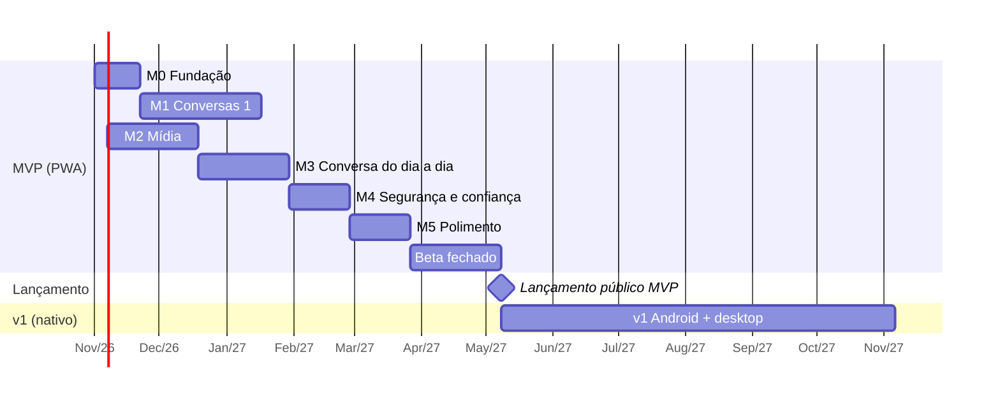

# 07 — Roadmap

- **Status:** ✅ aprovado
- **Última atualização:** 2026-10-22

## Premissas

- **Dedicação:** ~5 h por semana, com o Claude ajudando na implementação. As estimativas incluem o tempo de revisar, testar e entender o código, não só de escrevê-lo.
- **Estimativas em semanas de trabalho** (1 semana = ~5 h). São faixas, não promessas: revisar a cada marco concluído.
- **Lançamento em duas etapas:** beta fechado (você + 10–20 amigos e familiares) antes de abrir ao público.
- Início considerado: **novembro de 2026**.

## Visão geral

Somando: **~31 semanas de desenvolvimento + 6 de beta** (eram 33 antes da repriorização de 2026-10-22) → MVP público por volta do **3º trimestre de 2027**; v1 por volta do **1º trimestre de 2028**.

## MVP (PWA)

### Ordem do restante do MVP (repriorizada em 2026-10-22)

Critério escolhido pelo Pedro: **uso no dia a dia**, o que faz um grupo de amigos usar o app em vez do WhatsApp. A suíte e2e vem antes, para os bugs pararem de chegar ao celular. Ritmo real até aqui: de 16 a 22/10 saíram M0 (menos as esperas), M1, quase todo o M2 e os grupos, o equivalente a ~15 semanas das estimativas (Q-M1).

1. Suíte de testes de ponta a ponta na CI (M2), e em seguida a homologação antes da produção ([ADR-0007](adr/0007-homologacao.md)).
2. Fotos e encaminhar sem reenviar (M2).
3. Responder e reagir (M3).
4. Status de entrega e de leitura (M3).
5. Etapa 3 de UX/UI: aviso de sem conexão, tamanho da letra, nível do microfone (M3).
6. Cartão de perfil privado com nome e foto (M3).
7. Editar mensagem e mencionar com `@` (M3).
8. Backup cifrado de contatos, grupos e configurações (M4).
9. Pedidos de mensagem, bloqueio e prova de trabalho (M4).
10. Detecção de perdas (M4).
11. Polimento (M5), revisão de prontidão e beta.

**Achados e pedidos do Pedro depois de usar o app (2026-10-26), ainda sem implementar:**

- **Bug (✅ corrigido em 2026-10-26, teste e2e `envio-sem-rede`):** ao adicionar uma pessoa nova com os relays fora do ar, a mensagem "sumia" ao enviar, em vez de ficar pendente e sair depois. Causa encontrada no código: no envio 1:1, a busca de onde o contato recebe (`deliveryRelays`, até ~10 s por relay fora do ar) roda **antes** de guardar a mensagem. Enquanto isso o campo já foi limpo e nada aparece na conversa; se a busca falha ou a pessoa sai da tela, a mensagem se perde. A fila de envio (outbox) existe e funciona, mas só recebe a mensagem depois. Correção: a mensagem é guardada como "pendente" primeiro e os relays são buscados depois (RNF-12). Se não houver para onde enviar (`NoRelaysError`), ela é removida e o texto volta ao campo. Sobra uma janela de ~10 s em que fechar o app deixa a mensagem pendente sem entrada na fila; fica anotada.
- **Excluir conversa** (apagar do aparelho; backlog, M3). Hoje só se apagam mensagens (RF-25).
- **"Testadora" suja a lista (causa confirmada em 2026-10-26):** o teste e2e "Enviar comentário" (`comentario.spec.ts`) cria uma conta chamada Testadora e manda o comentário para a conta de comentários (`FEEDBACK_INVITE`, que traz os **relays reais** no nprofile). Em toda rodada da suíte, local ou na CI, uma chave nova manda uma mensagem de verdade para a conta do Pedro. Falta fazer a suíte não sair para a rede real (bug, vem antes). Isso também mostra o buraco que continua valendo: quem não é contato aparece na lista de conversas. Pedido para **antecipar os pedidos de mensagem e o bloqueio** (RF-12, RF-13, item 9 da ordem) e permitir excluir a conversa (acima).
- **Onboarding:** copiar e guardar 12 palavras é contraintuitivo (RF-03). Em estudo, ver Q-U1.
- **Fila de envio fora de ordem e lenta depois de ficar offline (✅ corrigido em 2026-10-26, testes `sync.test.ts`):** o Pedro mandou 4 mensagens sem internet e a primeira saiu mais de 1 minuto depois das outras. Causa: a fila tentava mesmo sem internet e a espera crescente (5 s, 15 s, 60 s…) ficava maior na mensagem que falhou primeiro, que então saía **depois** das que entraram depois dela; ao voltar a internet só saía o que já estava no prazo. Correção: a fila sai na ordem em que as mensagens foram escritas (`queuedAt`); sem internet no aparelho ela espera sem gastar tentativas; ao voltar a internet a espera anterior é esquecida e tudo sai já; os itens saem em lotes de 5, e o que entra durante a rodada sai na mesma rodada. A **ordem que a pessoa vê** já era garantida pelo horário do rumor (`sendTime` nunca repete nem recua dentro da conversa); a chegada ao relay agora também segue a ordem. Teste e2e `envio-sem-rede` confere as 4 mensagens offline, mas não pega o bug antigo sozinho (precisaria de várias falhas seguidas); quem pega são os três testes novos do motor.
- **Promoção de administrador perdida (✅ corrigido em 2026-10-26, teste `groups.test.ts` e e2e `grupos`):** achado quando o e2e de grupos falhava de vez em quando na CI (já falhava antes dos PRs do dia: confirmado num checkout anterior). Guardar um aviso de grupo lê os avisos, recalcula o estado e grava a conversa; um aviso que chega pela rede (a apresentação de quem acabou de entrar) junto com uma ação da pessoa na tela fazia a gravação mais lenta apagar a outra, e a promoção sumia da tela da Ana. Correção: as gravações da conversa esperam a vez, uma por banco (`conversations/lock.ts`), em avisos de grupo, mensagens recebidas e enviadas, o balão provisório do áudio, marcar como lida e apagar para mim. Fica de fora `markDeleted` (chamada por dentro de `storeIncoming`). Teste do core reproduz a perda sem a correção (várias ordens e atrasos); e2e de grupos repetido 30 vezes sob carga, sem falha.
- **Faixa de sem conexão (✅ ajustado em 2026-10-26):** a pílula no meio da tela atrapalhava; virou uma faixa fina presa no topo, no fluxo da página (a conversa encolhe o mesmo tanto).
- **Internacionalização (backlog, pedido do Pedro em 2026-10-26; ainda sem implementar).** Desacoplar os textos em português para ter outras línguas. O RNF-71 já pede textos externalizados, mas hoje **não está cumprido**: o português está direto nos componentes Svelte, em `errors.ts` (`friendlyError`), em `teste.ts`, nas mensagens de erro do core, no guia e no roteiro de teste; as datas usam `pt-BR` fixo (`format.ts`, `Avatar`, `localeCompare`) e o `app.html` tem `lang="pt-BR"`. Caminho proposto: (1) escolher o mecanismo e registrar num ADR (candidatos: Paraglide JS, compilado e tipado, bom para PWA pequeno; svelte-i18n; ou um módulo próprio mínimo de chaves tipadas); (2) o core não carrega texto de interface: devolve códigos e estruturas (como já fazem `GroupNotice` e os erros por `name`) e a interface traduz; (3) extrair os textos por área, começando pelo primeiro uso (cadastro, PIN, conversa), com pt-BR como língua-base; (4) idioma pelo navegador (`navigator.languages`) com escolha em Ajustes, guardada nas configurações, e `lang` do HTML e `Intl` com a mesma localidade (RNF-72); plurais tratados pela biblioteca; (5) teste que falha se sobrar texto fixo e se faltar chave em alguma língua; (6) convite e mensagens que o app escreve em nome da pessoa (avisos de grupo, "comentário") também entram. Quanto antes, mais barato: cada tela nova acrescenta textos fixos. Sugestão: depois do M3 e antes do M4. Em aberto: Q-I1, mecanismo e quais línguas depois do português (Pedro).

**Saíram do MVP para a v1** (decidido em 2026-10-22): modo foco com o estado "retida" (RF-52, 60–62), entrega em lotes (RF-63) e expiração de mídia com o painel de armazenamento (RF-72, 73). Ficam bem definidos nos docs para quando chegar a vez.

### M0 — Fundação (~3 semanas)

- Monorepo (`packages/core`, `packages/app`), TypeScript, Svelte, Vite, testes, integração contínua (GitHub Actions), licença AGPL-3.0.
- Publicar o PWA vazio no GitHub Pages.
- Pesquisar e testar relays e servidores Blossom para a lista padrão (Q-R1); criar `relays.json`.
- **Protótipo de medição:** abrir uma conexão com relays, cifrar/decifrar uma mensagem e rodar o Argon2id **no aparelho de referência** (Android 2 GB) para validar as metas de desempenho (Q-N4).

**Pronto quando:** o PWA "vazio" abre no celular de referência; os testes rodam a cada commit; existe uma lista inicial de pelo menos 5 relays compatíveis.

**Andamento (2026-10-22):** monorepo, CI, licença e PWA publicados; protótipo de medição pronto e rodado num celular intermediário (não o de referência); lista provisória com 7 relays aptos. Faltam: medir no aparelho de 2 GB (decide o ADR-0002) e confirmar a retenção dos relays a partir de 2026-10-29.

### M1 — Conversas 1:1 (~8 semanas)

- Identidade: criação, frase de recuperação em português com teste de verificação, PIN, restauração (RF-01, 03, 04, 05).
- Contatos por QR e link de convite; nome local (RF-10, 11, 14).
- Envio e recebimento de texto via NIP-17; lista de conversas; não lidas (RF-20, 21).
- Motor de sincronização: cursor, margem de 2 dias, deduplicação, fila offline (RF-80, 81; RNF-30..35).
- Banco local (Dexie) com as tabelas de identidade, contatos, conversas, mensagens, fila, sincronização.

**Pronto quando:** duas pessoas em aparelhos diferentes criam a identidade, se adicionam por QR e trocam mensagens, inclusive com um dos dois offline por um dia; restaurar a identidade num aparelho novo funciona.

### M2 — Mídia (~6 semanas)

- Áudio: gravação, envio, reprodução 1x/1,5x/2x (RF-40); decidir o formato no Safari (Q-R2).
- Fotos: compressão, prévia leve, download sob demanda (RF-41, 71).
- Cifra e envio ao Blossom; deduplicação por hash; encaminhar sem reenviar (RF-42, 70).
- ~~Expiração de mídia (30 dias, "guardar") e painel de armazenamento (RF-72, 73).~~ Adiado para a v1 (2026-10-22).
- **Suite de testes de ponta a ponta** (`packages/e2e`, Playwright): cadastro e PIN, restauração, convite e QR, conversa entre duas pessoas, áudio, atualização do app e comentário. Roda sob demanda, com o rótulo `e2e-tests` no PR, e passa a ser exigida para o merge ([ADR-0006](adr/0006-fluxo-de-trabalho-e-releases.md), 2026-10-22). Daqui em diante, cada funcionalidade nova entra com o seu teste. Decidido pelo Pedro em 2026-10-22: relays e Blossom locais (os `FakeRelay` e `FakeBlossom` do core), só pelo rótulo, entrega em partes. ✅ Parte 1 (2026-10-22): pacote com Playwright no Chrome instalado, servidores locais, job na CI e três fluxos (cadastro e PIN com recuperação, conversa entre duas pessoas, tela da conversa com balões e teclado); roda em ~10 s. ✅ Parte 2 (2026-10-22): áudio (gravar com microfone simulado, tocar, velocidade, um por vez) e apagar (para todos, com o arquivo saindo dos dois Blossom, e para mim); os Blossom locais passaram a ser dois e a servir em https. ✅ Parte 3 (2026-10-22): grupos e gestão com quatro pessoas. ✅ Parte 4 (2026-10-22): contatos e QR, "Mensagens novas", data no topo; achou um bug, corrigido: a conversa com não lidas às vezes abria no topo. ✅ Parte 5 (2026-10-22): copiar mensagem, guia e "Enviar comentário", aviso de versão nova com "Atualizar" e autocorreção da tela branca sem laço. Ficam nos rascunhos: os extras da identidade e do PIN (bloquear, esqueci o PIN, limite de tentativas), o pedido de contato e a publicação por cima de um app antigo com o cache do Pages.
- **Homologação antes da produção** ([ADR-0007](adr/0007-homologacao.md), decidido pelo Pedro em 2026-10-22): a cada merge na `main`, o app vai para um GitHub Pages de uma organização GitHub separada (origem própria, para não dividir IndexedDB e Cache Storage com a produção); o Pedro confere no celular e a release promove o commit validado. Distinguir a homologação na tela e no ícone do PWA. A skill `publicar` ganha a regra de versão: minor se algum PR traz algo que o testador vê de novo, patch se só correções, nada a lançar se só testes, docs ou bastidores. ✅ Implementado em 2026-10-22: organização `lerolero-app`, https://lerolero-app.github.io/lerolero/, workflow `homologacao.yml`, release a partir do `commit.txt`, moldura laranja "Homologação".
- ~~Cartão de perfil privado com nome e foto (Q-P5, RF-02).~~ Passou para o M3 (2026-10-22).
- **Excluir áudio e mídia:** apagar para mim (mensagem e arquivo no aparelho) e apagar para todos (pedido cifrado ao contato, como no RF-25, e remoção do arquivo dos servidores Blossom por quem enviou).
- **Melhorias de UX/UI** (escolhidas pelo Pedro em 2026-10-22), em 3 etapas:
  1. Tela inicial: lista de conversas ocupando a tela, com ícones de Contatos e Ajustes e botão flutuante de nova conversa; avatares com iniciais (cor fixa por contato) na lista e no topo da conversa; estado vazio com "Convidar alguém" e "Ler QR code".
  2. Conversa: balões seguidos da mesma pessoa agrupados; data do dia presa no topo ao rolar; botão "ir para o fim" com o número de mensagens novas e linha "Mensagens novas"; "Copiar" no menu da mensagem, com vibração curta ao abrir.
  3. ~~Geral~~ (passou para o M3 em 2026-10-22): aviso de "sem conexão"; tamanho da letra em Ajustes (Normal, Grande, Muito grande; RNF-65); nível do microfone durante a gravação.
- **Ajustes pedidos pelo Pedro depois de usar o app (2026-10-22):** ✅ recarregar a página sem pedir o PIN se o app foi usado nos últimos 5 minutos (T16); ✅ áudio a ~28 kbps, porque em lugar barulhento a voz ficava ruim. O controle automático de volume, ligado junto, cortava a voz no começo dos áudios gravados em lugar barulhento (visto pelo Pedro no celular) e foi desligado em 2026-10-22; o resto ficou melhor com a taxa maior. Pedro conferiu: sem cortes, voz alta e clara, mas o som ainda fica **um pouco feio** em lugar barulhento (só registrado; candidatos: RNNoise, acima, ou ajustar a taxa). Se ainda não bastar, supressão de ruído forte no aparelho (RNNoise em WebAssembly, ~150 KB a mais no app). Conferido: a hora mostrada na mensagem já é a do envio (vem do celular de quem enviou).
- **Áudio: qualidade, silêncio no começo e envio (pedidos do Pedro em 2026-10-26, só registrados, nada implementado):**
  - **Envio com cara de lento (✅ feito em 2026-10-26, teste e2e `audio-sem-rede`).** Antes, `sendAudio` só mostra a mensagem depois de cifrar e subir o arquivo para os dois Blossom; até lá a tela mostra "Enviando áudio…" no lugar do balão. Proposta: guardar a mensagem e o arquivo no aparelho na hora (como o texto "pendente", RNF-12) e mostrar o balão de áudio já tocável, com um indicador de "enviando" (relógio, ou progresso) até o envio terminar; tirar o aviso "Enviando áudio…". Precisa de uma fila para o envio do arquivo (guardar o arquivo cifrado para tentar de novo se o Blossom falhar, hoje a falha perde o áudio e mostra um erro). Decidido pelo Pedro em 2026-10-26: tentar por **minutos, não horas**, com espera que dobra a cada falha (2 s, 4 s, 8 s… até 60 s) e sorteio (jitter) entre a metade e o total; passados 5 minutos desiste, e o balão mostra "Não foi possível enviar" com **Tentar de novo** e **Apagar**. Implementado sem mudar o esquema do banco: o estado vai em `upload` no registro da mensagem e numa lista nas configurações; o balão provisório (id `envio:…`) é trocado pela mensagem de verdade quando o envio termina, e as tentativas são retomadas ao abrir o app ou voltar a rede. Apagar o balão que não saiu cancela o envio. Limite conhecido: se o áudio tocava quando o envio terminou, o balão é recriado e a reprodução recomeça.
  - **Silêncio no começo (✅ feito em 2026-10-26, testes `voice-start.test.ts` e e2e `audio-inicio`).** Escolhido o caminho (a) com detecção ao gravar: o app lê o nível do microfone em janelas de ~20 ms (`VoiceStartDetector`), acha onde a voz começa (5 janelas seguidas acima de 3× o ruído de fundo e de um mínimo) e guarda o ponto de início, com 0,3 s de folga, na tag `start` da mensagem; o player começa dali, mostra só o que vai tocar, e a barra continua inteira para voltar ao começo. Pula menos de 0,6 s? Não pula. Na dúvida não corta: ruído alto ou voz baixa fazem o detector não achar a voz e o áudio toca inteiro. O arquivo não é recodificado. Achado no caminho (corrigido): a barra do player não deixava arrastar para outro ponto de áudios gravados no navegador enquanto não terminavam, porque o Chrome os entrega com duração infinita e o player exigia duração finita; agora basta o áudio ser `seekable`. Antes, o plano era: A gravação começa no toque, e entre o toque, a abertura do microfone (`getUserMedia`) e a pessoa começar a falar sobra um trecho vazio. Caminhos, do mais barato: (a) cortar o começo sem recodificar, guardando um deslocamento de início na mensagem e começando a tocar dali; (b) abrir o microfone ao tocar no campo de mensagem, ou ao segurar, para a gravação começar sem atraso; (c) detectar o primeiro trecho com voz na hora de enviar e cortar (precisa recodificar ou cortar no contêiner). A medir antes: quanto do silêncio vem do atraso do microfone e quanto vem da pessoa.
  - **Qualidade do som.** Já está em Opus a 28 kbps com supressão de ruído e cancelamento de eco do navegador. Opções para testar, com comparação lado a lado de gravações no Motorola do Pedro: subir a taxa (36 a 48 kbps, ~270 a ~360 KB/min); desligar o cancelamento de eco, que sem alto-falante por perto só deforma a voz; ajustar o modo do Opus para voz; supressão de ruído por RNNoise em WebAssembly (~150 KB a mais no app, já estava como candidato acima); e conferir se o navegador do celular está gravando em 48 kHz mono. Decidir pela escuta, não por número.
- **Aviso de versão nova mais rápido** (notado pelo Pedro em 2026-10-22, só registrado): hoje o aviso pode levar 10 minutos ou mais depois da publicação. A CI leva ~1 minuto; o GitHub Pages guarda os arquivos em cache por até 10 minutos (`max-age=600`); e o app só procura versão nova quando volta para a tela. Melhorias possíveis: procurar também a cada poucos minutos com o app aberto. O cache do Pages não dá para encurtar; com domínio próprio (Q-N1) e outro hospedeiro, sim.
- ~~**Bug: o teclado esconde as mensagens numa conversa com poucas mensagens**~~ (visto pelo Pedro no celular em 2026-10-22) ✅ corrigido em 2026-10-22: no Chrome do Android o teclado só encolhia a parte visível e o navegador empurrava a página toda para cima. Agora a meta viewport pede `interactive-widget=resizes-content` (a página encolhe de verdade), as mensagens ficam alinhadas junto do campo e a conversa que estava no fim continua no fim quando a área encolhe. Teste de regressão na suíte e2e (`packages/e2e/testes/tela-da-conversa.spec.ts`).
- ~~**Bug: mensagens mandadas no mesmo segundo aparecem fora de ordem**~~ (achado no teste da etapa 2 de UX, 2026-10-22) ✅ corrigido em 2026-10-22: o horário do Nostr é em segundos e o empate era decidido pelo id, ao acaso. Agora cada mensagem sai datada depois da última da conversa (no máximo 60 s à frente), como já acontecia com os avisos de grupo. Teste de regressão no core (`messaging.test.ts`). Faltava um caso, achado no teste do botão "ir para o fim": a primeira mensagem para alguém novo espera a busca dos relays, e a segunda, mandada nesse meio-tempo, pegava o mesmo segundo; agora os envios saem em fila (regressão em `prototipos/e2e-rascunho/novas.mjs`).

**Andamento (2026-10-22):** Blossom, áudio (Opus a ~17 kbps, Q-R2 resolvida) e exclusão de mensagens e áudios prontos e publicados; etapa 1 de UX/UI publicada. **Grupos (RF-30..33) adiantados do M3** a pedido do Pedro (2026-10-22): são o uso principal no Brasil e mudam a tela da conversa (nome de quem escreveu nos balões), então a etapa 2 de UX vem depois, já pensada para grupos. Ordem a seguir: grupos (✅ core: dados e envio/recebimento; ✅ tela: criar o grupo e conversar nele, com avisos na conversa e nome de quem escreveu nos balões; ✅ gestão: tela de detalhes do grupo, aberta ao tocar no nome do grupo no topo da conversa (pedido do Pedro em 2026-10-22), com membros e papéis, adicionar pessoas, remover, promover e rebaixar administradores, renomear e sair; cada ação só aparece para quem tem permissão), etapa 2 de UX/UI (✅ balões seguidos agrupados, com a pontinha só no último; ✅ data do dia no topo enquanto se rola, que some quando a rolagem para; ✅ botão "ir para o fim" com o número de mensagens que chegaram e linha "Mensagens novas", que ao abrir fica antes da primeira não lida; ✅ "Copiar" no menu da mensagem, com vibração curta ao abrir — etapa 2 concluída), suite e2e e fotos (nova ordem acima; a etapa 3 de UX e o cartão de perfil passaram para o M3, a expiração para a v1).

**Pronto quando:** os critérios de aceite "Mídia salva uma vez" passam; 1 minuto de áudio fica em torno de 210 KB e uma foto em até 200 KB.

### M3 — Conversa do dia a dia (~6 semanas)

Antes "Grupos e recursos de conversa"; os grupos foram adiantados para o M2 e o marco foi reorganizado em 2026-10-22.

- ~~Grupos de até 20 com tag `g` e eventos de controle; administrador; remover membro (RF-30..33).~~ Adiantado para o M2 (2026-10-22).
- Responder e reagir (RF-22, 23).
- Status de entrega com confirmações agrupadas; confirmação de leitura desativável (RF-50, 51).
- Etapa 3 de UX/UI (veio do M2): ✅ aviso de "sem conexão" (2026-10-26: pílula acima do campo de mensagem quando o aparelho fica sem internet, na hora, ou sem nenhum relay conectado por 6 s; some sozinha quando volta; teste e2e `sem-conexao`); tamanho da letra em Ajustes (Normal, Grande, Muito grande; RNF-65); nível do microfone durante a gravação.
- Cartão de perfil privado com nome e foto (Q-P5, RF-02; veio do M2).
- Editar mensagem (RF-24). ~~Apagar para todos (RF-25)~~ feito no M2.
- Mencionar alguém no grupo com `@` (RF-35). Sem modo foco no MVP, não há exceção a avaliar por enquanto (RF-61, v1).

**Pronto quando:** um grupo de 5 pessoas conversa com respostas, reações e menções; os status aparecem corretamente.

### M4 — Segurança e confiança (~4 semanas)

Antes "Atenção e segurança"; o modo foco e a entrega em lotes foram para a v1 (2026-10-22) e a detecção de perdas veio do M3.

- Backup cifrado de contatos, grupos e configurações (RF-06).
- Pedidos de mensagem, bloqueio, prova de trabalho (RF-12, 13, 90).
- Detecção de perdas: numeração por conversa + pedido de reenvio + prazo de 7 dias (RF-53).
- ~~Modo foco (Reter) e estado "retida" (RF-52, 60..62); entrega em lotes (RF-63).~~ Adiados para a v1 (2026-10-22).

**Pronto quando:** o critério de aceite "Perda de identidade" passa; a prova de trabalho leva menos de 1 s no aparelho de referência; uma mensagem apagada propositalmente de um relay de teste é detectada e reenviada.

### M5 — Polimento (~4 semanas)

- Revisão de acessibilidade WCAG 2.2 AA com leitor de tela (RNF-60..63).
- Revisão de textos para linguagem simples (RNF-64).
- Medição de todas as metas de desempenho e dados no aparelho de referência (seções 2 e 3 do [04](04-requisitos-nao-funcionais.md)).
- Correção dos problemas encontrados; *Could* (RF-02, 26) só se sobrar tempo.

**Pronto quando:** as metas de desempenho são atingidas ou têm justificativa documentada; o fluxo de primeiro uso leva menos de 2 minutos com uma pessoa leiga.

### Revisão de prontidão para produção (antes do beta)

Revisão do app inteiro com olhar de operação. Como não há servidor do projeto, cada tema muda de foco:

| Tema | O que revisar |
|---|---|
| Confiabilidade | Entrega de mensagens de ponta a ponta (perdas, repetidas, ordem), fila offline, retenção real dos relays, comportamento com relays e servidores Blossom fora do ar |
| Escalabilidade | Limites e capacidade dos relays e servidores Blossom de terceiros (taxa de envio, tamanho, retenção); dependência de poucos operadores; desempenho do app com muitas conversas e mensagens no aparelho de referência |
| Resiliência | Recuperação de falhas: reconexão, troca de relays, lista padrão atualizável (RNF-36), dados locais apagados pelo navegador, restauração pela frase |
| Segurança | Auditoria externa da criptografia e do cofre; dependências e cadeia de suprimentos (npm, CI); política de segurança de conteúdo (CSP) do PWA; tratamento de dados vindos de fora; canal para relatar vulnerabilidades |
| Monitoramento | Sondas sintéticas (contas de teste trocando mensagens pela rede real, a partir da CI), painel de saúde dos relays e servidores Blossom, diagnóstico local enviado pela própria pessoa (Enviar comentário); decidir a Q-N6 (dados técnicos de uso com consentimento) |
| Lançamento e volta atrás | Processo de publicação, como reverter uma versão ruim (service worker, cache), migrações do banco local sem perder dados, comunicação de incidentes a quem usa |

**Pronto quando:** cada tema tem os riscos listados com mitigação ou aceite documentado, e os itens críticos estão resolvidos.

### Beta fechado (~6 semanas de uso)

- 10–20 pessoas, incluindo pelo menos algumas idosas ou com pouca familiaridade digital (RNF-65).
- Canal simples de feedback (ex.: um grupo no próprio app).
- Acompanhar: mensagens perdidas, dificuldades de cadastro, consumo de dados, travamentos.

**Pronto para o lançamento público quando:**
- nenhuma perda de mensagem sem detecção;
- todos os participantes conseguiram cadastrar, adicionar contatos e mandar áudio sem ajuda;
- orientação jurídica obtida (Q-N3);
- decisão sobre domínio próprio (Q-N1);
- guia publicado para voluntários rodarem relays e servidores Blossom (Q8 da Visão).

## v1 — Android e desktop nativos (~26 semanas)

| Item | Requisitos |
|---|---|
| App Android com Capacitor; APK direto assinado | RNF-02, 81 |
| Notificações com UnifiedPush; decidir quem dispara o "acorde" ([ADR-0005](adr/0005-notificacoes.md)) | RF-82 |
| App desktop com Tauri: bandeja, conexão própria, notificações | RNF-03, 83 |
| Chave no cofre do sistema; PIN/biometria opcional | RF-07, RNF-42 |
| Figurinhas, incluindo a figurinha sonora (Q-F5, Q-P2) | RF-43 |
| Modos de banda | RF-74 |
| Modo foco: Reter (manual, por tempo, agendado, exceções) e estado "retida" (adiados do MVP em 2026-10-22); Pausar; aviso automático | RF-52, 60–62, 64, 65 |
| Entrega em lotes (adiada do MVP em 2026-10-22) | RF-63 |
| Expiração de mídia e painel de armazenamento (adiados do MVP em 2026-10-22) | RF-72, 73 |
| Mensagens temporárias | RF-27 |
| Builds reproduzíveis do APK | RNF-46 |

**Programa de relays brasileiros (em paralelo):** documentação, contato com comunidades de software livre, universidades e coletivos; meta de N operadores brasileiros independentes (métrica da [Visão](01-visao.md)).

## Futuro (sem ordem definida)

- **Forward secrecy com Marmot (MLS)** — reavaliar ~12 meses após o ADR-0001 (out/2027).
- Grupos grandes (RF-34).
- **Seleção de várias mensagens (RF-28, pedido do Pedro em 2026-10-26, só registrado):** tocar numa mensagem para entrar no modo de seleção, marcar várias e agir de uma vez: **favoritar**, **excluir** (para mim ou para todos, com as regras do RF-25), **copiar** (textos juntos, na ordem da conversa) e **encaminhar** (a mídia vai sem reenviar o arquivo, RF-70). Hoje cada ação é por mensagem, no menu do toque longo (excluir e copiar já existem). Pontos a decidir antes: onde ficam os favoritos (uma tela "Favoritas" no Ajustes, ou um filtro na conversa) e se favoritar é só local (proposta: sim, nunca vai para o contato, e entra no backup cifrado do RF-06); encaminhar depende de "fotos e encaminhar sem reenviar" (item 2 da ordem do MVP); excluir várias para todos manda um único pedido cifrado com todos os ids. Quando entrar, o toque longo passa a iniciar a seleção, e o menu atual vira a barra de ações.
- Multi-dispositivo.
- Chamadas de voz e vídeo.
- iOS; Google Play (Q-N2); notarização no macOS (Q-N5).
- Recuperação de conveniência: passkeys, Pix, gov.br (RF-08, Q-A6, Q-A7) e busca por CPF/Pix (RF-15).
- Antigolpe: verificação de contato, alerta de chave nova, alertas locais (RF-16, Q-A4).
- Denúncia e listas de bloqueio compartilhadas (RF-17).
- Resumo periódico (RF-66); arquivos e vídeos (RF-44).

## Pontos de decisão

| Quando | Decisão |
|---|---|
| Fim do M0 | O desempenho medido no aparelho de referência confirma PWA + Svelte? Se não, rever o [ADR-0002](adr/0002-stack-do-cliente.md) |
| Fim do beta | Lançar publicamente ou fazer mais uma rodada de correções |
| Início da v1 | Quem dispara o push no Android; Capacitor ou Tauri 2 para Android |
| Out/2027 | Marmot está maduro o suficiente para forward secrecy? ([ADR-0001](adr/0001-protocolo-de-transporte.md)) |

## Questões em aberto

| # | Questão | Responsável |
|---|---|---|
| Q-M1 | Revisar as estimativas ao fim do M1, com base no ritmo real | Pedro |
| Q-I1 | Internacionalização: qual mecanismo (Paraglide, svelte-i18n ou módulo próprio) e quais línguas depois do português? Registrar em ADR | Pedro |
| Q-U1 | Como tornar o cadastro menos pesado sem perder a recuperação da conta? Hoje o RF-03 exige copiar e guardar 12 palavras. Pedido do Pedro em 2026-10-26: pensar em alternativas | Pedro |
